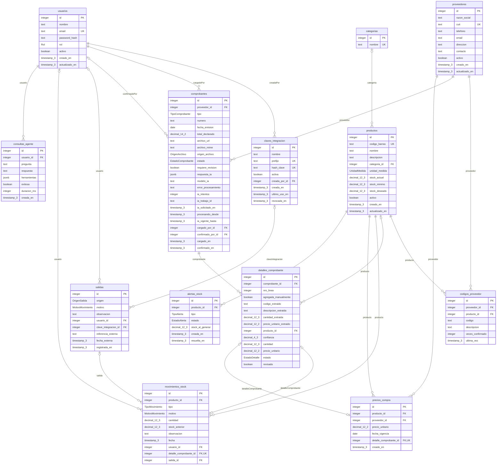

# Diseño de la base de datos de Remitto

> Documento generado con `npm run doc-bd` (en `backend/`) a partir de `backend/prisma/schema.prisma` y de las migraciones. No editar a mano: regenerarlo cuando cambie el modelo.

Motor: PostgreSQL 16, con Prisma 5.22.0 como ORM. 13 tablas y 11 tipos enumerados.

## Criterios de diseño

- **El stock se deriva de los movimientos.** `productos.stock_actual` es un valor cacheado: cada cambio pasa por un registro en `movimientos_stock`, en la misma transacción y con el stock anterior, y `stock_actual` coincide con la suma de los movimientos.
- **Lo leído por la IA se conserva aparte de lo confirmado.** `detalles_comprobante` guarda las columnas `*_extraido` y, por separado, el producto, la cantidad y el precio confirmados. `comprobantes.respuesta_ia` guarda la respuesta original.
- **Las reglas de negocio principales se aplican en la base** (RNF5): claves únicas, restricciones `CHECK` e índices únicos parciales, detallados más abajo.
- **No se borran registros con historia**: usuarios, productos y proveedores se desactivan (`activo`).
- Cantidades y precios se guardan como `decimal` exacto, nunca como punto flotante.

## Diagrama entidad-relación

Las imágenes [der-remitto.svg](referencias/der-remitto.svg) y [der-remitto.png](referencias/der-remitto.png) (para documentos e impresión) muestran el mismo diagrama, generado desde [der-remitto.mmd](referencias/der-remitto.mmd) con Mermaid. Al regenerar este documento, volver a renderizar las imágenes.

Notación: `||` uno obligatorio, `|o` cero o uno, `o{` cero o muchos. PK clave primaria, FK clave foránea, UK valor único.

## Tablas

| Tabla | Descripción |
| --- | --- |
| [usuarios](#usuarios) | Personas que operan el sistema, con rol propietario o empleado. No se borran: se desactivan. |
| [claves_integracion](#claves_integracion) | Credencial de un sistema externo (POS) autorizado a informar salidas. Nunca se guarda la clave en claro: solo su hash y un prefijo visible para que el propietario la identifique en la pantalla de configuración. |
| [categorias](#categorias) | Agrupación de productos para la navegación y los reportes. Un producto puede no tener categoría. |
| [productos](#productos) | Catálogo del comercio, con unidad de medida, stock mínimo y deseado. No se borra: se desactiva. |
| [proveedores](#proveedores) | Proveedores que envían los comprobantes. El CUIT, si se informa, es único. No se borra: se desactiva. |
| [codigos_proveedor](#codigos_proveedor) | Cómo nombra cada proveedor a cada producto en sus remitos. Se alimenta con cada confirmación y mejora la asociación automática en los comprobantes siguientes. |
| [comprobantes](#comprobantes) | Remito o factura de compra cargado como imagen o PDF, con su estado, la respuesta original de la IA y quién lo cargó y confirmó. |
| [detalles_comprobante](#detalles_comprobante) | Cada línea guarda por separado lo que leyó la IA y lo que confirmó el usuario. Nada con estado PROPUESTO genera movimientos. |
| [salidas](#salidas) | Cabecera que agrupa los movimientos de salida confirmados juntos. - CARRITO: usuarioId obligatorio, claveIntegracionId nulo. - INTEGRACION: claveIntegracionId y referenciaExterna obligatorios, usuarioId nulo. (Reglas aplicadas con CHECK en la migración SQL.) |
| [movimientos_stock](#movimientos_stock) | Entidad central. El stock de un producto es la suma de sus movimientos. Origen: una línea de comprobante (ENTRADA), una Salida (SALIDA) o ninguno (AJUSTE por recuento). |
| [precios_compra](#precios_compra) | Historial de precios de compra. Se genera automáticamente al confirmar un comprobante, pero admite cargas manuales (ej. lista de precios). |
| [alertas_stock](#alertas_stock) | Generadas por el observador de movimientos (patrón Observer). |
| [consultas_agente](#consultas_agente) | Registro de consultas al agente. Sirve para auditar y para medir el objetivo de "8 tipos de preguntas respondidas". |

### usuarios

Personas que operan el sistema, con rol propietario o empleado. No se borran: se desactivan.

| Columna | Tipo | Nulo | Clave / predeterminado | Descripción |
| --- | --- | --- | --- | --- |
| `id` | integer | no | PK · = autoincrement() | — |
| `nombre` | text | no | — | — |
| `email` | text | no | único | — |
| `password_hash` | text | no | — | — |
| `rol` | enum Rol | no | = EMPLEADO | — |
| `activo` | boolean | no | = true | — |
| `creado_en` | timestamp(3) | no | = now() | — |
| `actualizado_en` | timestamp(3) | no | se actualiza solo | — |

### claves_integracion

Credencial de un sistema externo (POS) autorizado a informar salidas. Nunca se guarda la clave en claro: solo su hash y un prefijo visible para que el propietario la identifique en la pantalla de configuración.

| Columna | Tipo | Nulo | Clave / predeterminado | Descripción |
| --- | --- | --- | --- | --- |
| `id` | integer | no | PK · = autoincrement() | — |
| `nombre` | text | no | — | — |
| `prefijo` | text | no | único | — |
| `hash_clave` | text | no | único | — |
| `activa` | boolean | no | = true | — |
| `creada_por_id` | integer | no | FK → usuarios | — |
| `creada_en` | timestamp(3) | no | = now() | — |
| `ultimo_uso_en` | timestamp(3) | sí | — | — |
| `revocada_en` | timestamp(3) | sí | — | — |

### categorias

Agrupación de productos para la navegación y los reportes. Un producto puede no tener categoría.

| Columna | Tipo | Nulo | Clave / predeterminado | Descripción |
| --- | --- | --- | --- | --- |
| `id` | integer | no | PK · = autoincrement() | — |
| `nombre` | text | no | único | — |

### productos

Catálogo del comercio, con unidad de medida, stock mínimo y deseado. No se borra: se desactiva.

| Columna | Tipo | Nulo | Clave / predeterminado | Descripción |
| --- | --- | --- | --- | --- |
| `id` | integer | no | PK · = autoincrement() | — |
| `codigo_barras` | text | sí | único | — |
| `nombre` | text | no | — | — |
| `descripcion` | text | sí | — | — |
| `categoria_id` | integer | sí | FK → categorias | — |
| `unidad_medida` | enum UnidadMedida | no | = UNIDAD | — |
| `stock_actual` | decimal(12,3) | no | = 0 | Valor cacheado. Se actualiza en la MISMA transacción que cada MovimientoStock. La fuente de verdad es SUM(movimientos.cantidad). Puede quedar negativo si el POS informa ventas no ingresadas. |
| `stock_minimo` | decimal(12,3) | no | = 0 | — |
| `stock_deseado` | decimal(12,3) | sí | — | Nivel al que se quiere llegar al reponer (base de la sugerencia). |
| `activo` | boolean | no | = true | — |
| `creado_en` | timestamp(3) | no | = now() | — |
| `actualizado_en` | timestamp(3) | no | se actualiza solo | — |

- Índice: (nombre)
- Índice: (categoria_id)

### proveedores

Proveedores que envían los comprobantes. El CUIT, si se informa, es único. No se borra: se desactiva.

| Columna | Tipo | Nulo | Clave / predeterminado | Descripción |
| --- | --- | --- | --- | --- |
| `id` | integer | no | PK · = autoincrement() | — |
| `razon_social` | text | no | — | — |
| `cuit` | text | sí | único | — |
| `telefono` | text | sí | — | — |
| `email` | text | sí | — | — |
| `direccion` | text | sí | — | — |
| `contacto` | text | sí | — | — |
| `activo` | boolean | no | = true | — |
| `creado_en` | timestamp(3) | no | = now() | — |
| `actualizado_en` | timestamp(3) | no | se actualiza solo | — |

### codigos_proveedor

Cómo nombra cada proveedor a cada producto en sus remitos. Se alimenta con cada confirmación y mejora la asociación automática en los comprobantes siguientes.

| Columna | Tipo | Nulo | Clave / predeterminado | Descripción |
| --- | --- | --- | --- | --- |
| `id` | integer | no | PK · = autoincrement() | — |
| `proveedor_id` | integer | no | FK → proveedores | — |
| `producto_id` | integer | no | FK → productos | — |
| `codigo` | text | sí | — | — |
| `descripcion` | text | no | — | — |
| `veces_confirmado` | integer | no | = 1 | — |
| `ultima_vez` | timestamp(3) | no | = now() | — |

- Único: (proveedor_id, codigo)
- Único: (proveedor_id, descripcion)
- Índice: (producto_id)

### comprobantes

Remito o factura de compra cargado como imagen o PDF, con su estado, la respuesta original de la IA y quién lo cargó y confirmó.

| Columna | Tipo | Nulo | Clave / predeterminado | Descripción |
| --- | --- | --- | --- | --- |
| `id` | integer | no | PK · = autoincrement() | — |
| `proveedor_id` | integer | no | FK → proveedores | — |
| `tipo` | enum TipoComprobante | no | = REMITO | — |
| `numero` | text | sí | — | — |
| `fecha_emision` | date | sí | — | — |
| `total_declarado` | decimal(14,2) | sí | — | — |
| `archivo_url` | text | no | — | — |
| `archivo_mime` | text | no | — | — |
| `origen_archivo` | enum OrigenArchivo | no | — | — |
| `estado` | enum EstadoComprobante | no | = PENDIENTE | — |
| `requiere_revision` | boolean | no | = false | true si la IA detecta texto manuscrito o baja calidad: se exige confirmar todas las líneas una por una. |
| `respuesta_ia` | jsonb | sí | — | Lectura de la IA: texto original, JSON tal como llegó, versión normalizada, motivos de revisión y métricas de la última ejecución. |
| `modelo_ia` | text | sí | — | — |
| `error_procesamiento` | text | sí | — | — |
| `ia_intentos` | integer | no | = 0 | Llamadas reales al modelo; se suma ANTES de cada envío (cuota). |
| `ia_trabajo_id` | text | sí | — | Dueño del trabajo vigente: toda escritura del trabajo lo exige. |
| `ia_solicitado_en` | timestamp(3) | sí | — | Momento en que se pidió el procesamiento (mide la espera en cola). |
| `procesando_desde` | timestamp(3) | sí | — | Inicio de la ejecución; NULL mientras el trabajo espera en la cola. |
| `ia_vigente_hasta` | timestamp(3) | sí | — | Vigencia renovada por el latido del proceso dueño. Si vence, el trabajo se considera abandonado (ERROR INTERRUMPIDO). |
| `cargado_por_id` | integer | no | FK → usuarios | — |
| `confirmado_por_id` | integer | sí | FK → usuarios | — |
| `cargado_en` | timestamp(3) | no | = now() | — |
| `confirmado_en` | timestamp(3) | sí | — | — |

- Único: (proveedor_id, tipo, numero)
- Índice: (estado)
- Índice: (cargado_en)
- CHECK `chk_ia_intentos`: `"ia_intentos" >= 0` — Las llamadas a la IA nunca son negativas
- CHECK `chk_procesando_con_trabajo`: `"estado" <> 'PROCESANDO' OR ("ia_trabajo_id" IS NOT NULL AND "ia_vigente_hasta" IS NOT NULL AND "ia_solicitado_en" IS NOT NULL)` — Un comprobante en PROCESANDO siempre tiene dueño, vigencia y hora de solicitud
- CHECK `chk_comprobante_confirmado`: `"estado" <> 'CONFIRMADO' OR ( "confirmado_por_id" IS NOT NULL AND "confirmado_en" IS NOT NULL AND "numero" IS NOT NULL )` — Un comprobante confirmado registra quién y cuándo, y tiene número.

### detalles_comprobante

Cada línea guarda por separado lo que leyó la IA y lo que confirmó el usuario. Nada con estado PROPUESTO genera movimientos.

| Columna | Tipo | Nulo | Clave / predeterminado | Descripción |
| --- | --- | --- | --- | --- |
| `id` | integer | no | PK · = autoincrement() | — |
| `comprobante_id` | integer | no | FK → comprobantes | — |
| `nro_linea` | integer | no | — | — |
| `agregada_manualmente` | boolean | no | = false | — |
| `codigo_extraido` | text | sí | — | — |
| `descripcion_extraida` | text | sí | — | — |
| `cantidad_extraida` | decimal(12,3) | sí | — | — |
| `precio_unitario_extraido` | decimal(12,2) | sí | — | — |
| `producto_id` | integer | sí | FK → productos | — |
| `confianza` | decimal(4,3) | sí | — | — |
| `cantidad` | decimal(12,3) | sí | — | — |
| `precio_unitario` | decimal(12,2) | sí | — | — |
| `estado` | enum EstadoDetalle | no | = PROPUESTO | — |
| `revisada` | boolean | no | = false | HU17: en un comprobante manuscrito o de baja calidad, la persona marca cada línea como revisada antes de poder confirmar el ingreso. |

- Único: (comprobante_id, nro_linea)
- Índice: (producto_id)
- CHECK `chk_confianza`: `"confianza" IS NULL OR ("confianza" >= 0 AND "confianza" <= 1)` — Confianza de la IA entre 0 y 1
- CHECK `chk_detalle_confirmado`: `"estado" <> 'CONFIRMADO' OR ("producto_id" IS NOT NULL AND "cantidad" > 0)` — Una línea confirmada siempre tiene producto y una cantidad positiva.
- CHECK `chk_detalle_precio`: `"precio_unitario" IS NULL OR "precio_unitario" >= 0` — El precio unitario confirmado nunca es negativo.

### salidas

Cabecera que agrupa los movimientos de salida confirmados juntos. - CARRITO: usuarioId obligatorio, claveIntegracionId nulo. - INTEGRACION: claveIntegracionId y referenciaExterna obligatorios, usuarioId nulo. (Reglas aplicadas con CHECK en la migración SQL.)

| Columna | Tipo | Nulo | Clave / predeterminado | Descripción |
| --- | --- | --- | --- | --- |
| `id` | integer | no | PK · = autoincrement() | — |
| `origen` | enum OrigenSalida | no | — | — |
| `motivo` | enum MotivoMovimiento | no | = VENTA | — |
| `observacion` | text | sí | — | — |
| `usuario_id` | integer | sí | FK → usuarios | — |
| `clave_integracion_id` | integer | sí | FK → claves_integracion | — |
| `referencia_externa` | text | sí | — | INTEGRACION: id de la operación en el sistema externo (ticket, venta). CARRITO: id de operación que genera la app (HU13). Garantiza idempotencia: un reenvío no descuenta dos veces. Para el carrito la unicidad es por usuario (índice parcial en la migración SQL). |
| `fecha_externa` | timestamp(3) | sí | — | Momento en que ocurrió la venta según el sistema externo. |
| `registrada_en` | timestamp(3) | no | = now() | — |

- Único: (clave_integracion_id, referencia_externa)
- Índice: (registrada_en)
- Índice: (origen, registrada_en)
- CHECK `chk_origen_salida`: `("origen" = 'CARRITO' AND "usuario_id" IS NOT NULL AND "clave_integracion_id" IS NULL) OR ("origen" = 'INTEGRACION' AND "usuario_id" IS NULL AND "clave_integracion_id" IS NOT NULL AND "referencia_externa" IS NOT NULL)` — Origen de la salida coherente con quién la registró
- CHECK `chk_motivo_salida`: `"motivo" IN ('VENTA', 'CONSUMO_INTERNO', 'ROTURA', 'VENCIMIENTO', 'OTRO')` — Motivos válidos para una salida
- UNIQUE parcial `uq_salida_carrito_operacion`: `("usuario_id", "referencia_externa") WHERE "origen" = 'CARRITO' AND "referencia_externa" IS NOT NULL` — Un reintento del mismo carrito (mismo id de operación generado por la app) no descuenta dos veces. Las salidas de integración ya son únicas por (clave_integracion_id, referencia_externa); en el carrito esa clave es nula, por eso la unicidad es por usuario.

### movimientos_stock

Entidad central. El stock de un producto es la suma de sus movimientos. Origen: una línea de comprobante (ENTRADA), una Salida (SALIDA) o ninguno (AJUSTE por recuento).

| Columna | Tipo | Nulo | Clave / predeterminado | Descripción |
| --- | --- | --- | --- | --- |
| `id` | integer | no | PK · = autoincrement() | — |
| `producto_id` | integer | no | FK → productos | — |
| `tipo` | enum TipoMovimiento | no | — | — |
| `motivo` | enum MotivoMovimiento | no | — | — |
| `cantidad` | decimal(12,3) | no | — | Positiva en entradas, negativa en salidas. En ajustes: diferencia (stock contado - stock registrado). |
| `stock_anterior` | decimal(12,3) | no | — | Stock registrado justo antes del movimiento (auditoría). En un ajuste, stock contado = stockAnterior + cantidad. |
| `observacion` | text | sí | — | — |
| `fecha` | timestamp(3) | no | = now() | — |
| `usuario_id` | integer | sí | FK → usuarios | Nulo solo en salidas informadas por integración (la trazabilidad queda en salida.claveIntegracion). |
| `detalle_comprobante_id` | integer | sí | FK → detalles_comprobante · único | — |
| `salida_id` | integer | sí | FK → salidas | — |

- Único: (salida_id, producto_id)
- Índice: (producto_id, fecha)
- Índice: (tipo, fecha)
- CHECK `chk_signo_cantidad`: `("tipo" = 'ENTRADA' AND "cantidad" > 0) OR ("tipo" = 'SALIDA' AND "cantidad" < 0) OR ("tipo" = 'AJUSTE' AND "cantidad" <> 0)` — Signo de la cantidad según el tipo de movimiento
- CHECK `chk_salida_con_cabecera`: `("tipo" = 'SALIDA') = ("salida_id" IS NOT NULL)` — Toda salida pertenece a una cabecera Salida

### precios_compra

Historial de precios de compra. Se genera automáticamente al confirmar un comprobante, pero admite cargas manuales (ej. lista de precios).

| Columna | Tipo | Nulo | Clave / predeterminado | Descripción |
| --- | --- | --- | --- | --- |
| `id` | integer | no | PK · = autoincrement() | — |
| `producto_id` | integer | no | FK → productos | — |
| `proveedor_id` | integer | no | FK → proveedores | — |
| `precio_unitario` | decimal(12,2) | no | — | — |
| `fecha_vigencia` | date | no | — | — |
| `detalle_comprobante_id` | integer | sí | FK → detalles_comprobante · único | — |
| `creado_en` | timestamp(3) | no | = now() | — |

- Índice: (producto_id, proveedor_id, fecha_vigencia)

### alertas_stock

Generadas por el observador de movimientos (patrón Observer).

| Columna | Tipo | Nulo | Clave / predeterminado | Descripción |
| --- | --- | --- | --- | --- |
| `id` | integer | no | PK · = autoincrement() | — |
| `producto_id` | integer | no | FK → productos | — |
| `tipo` | enum TipoAlerta | no | — | — |
| `estado` | enum EstadoAlerta | no | = ACTIVA | — |
| `stock_al_generar` | decimal(12,3) | no | — | — |
| `creada_en` | timestamp(3) | no | = now() | — |
| `resuelta_en` | timestamp(3) | sí | — | — |

- Índice: (estado, producto_id)
- UNIQUE parcial `uq_alerta_activa`: `("producto_id", "tipo") WHERE "estado" = 'ACTIVA'` — Una sola alerta activa por producto y tipo

### consultas_agente

Registro de consultas al agente. Sirve para auditar y para medir el objetivo de "8 tipos de preguntas respondidas".

| Columna | Tipo | Nulo | Clave / predeterminado | Descripción |
| --- | --- | --- | --- | --- |
| `id` | integer | no | PK · = autoincrement() | — |
| `usuario_id` | integer | no | FK → usuarios | — |
| `pregunta` | text | no | — | — |
| `respuesta` | text | sí | — | — |
| `herramientas` | jsonb | sí | — | Herramientas invocadas por el agente y sus parámetros. |
| `exitosa` | boolean | no | = true | — |
| `duracion_ms` | integer | sí | — | — |
| `creada_en` | timestamp(3) | no | = now() | — |

- Índice: (creada_en)

## Relaciones

| Tabla padre | Tabla hija | Columna | Cardinalidad | Al borrar el padre |
| --- | --- | --- | --- | --- |
| usuarios | claves_integracion | `creada_por_id` | 1 a 0..N | Restrict (predeterminado) |
| categorias | productos | `categoria_id` | 0..1 a 0..N | SetNull |
| proveedores | codigos_proveedor | `proveedor_id` | 1 a 0..N | Cascade |
| productos | codigos_proveedor | `producto_id` | 1 a 0..N | Cascade |
| proveedores | comprobantes | `proveedor_id` | 1 a 0..N | Restrict (predeterminado) |
| usuarios | comprobantes | `cargado_por_id` | 1 a 0..N | Restrict (predeterminado) |
| usuarios | comprobantes | `confirmado_por_id` | 0..1 a 0..N | SetNull (predeterminado) |
| comprobantes | detalles_comprobante | `comprobante_id` | 1 a 0..N | Cascade |
| productos | detalles_comprobante | `producto_id` | 0..1 a 0..N | SetNull |
| usuarios | salidas | `usuario_id` | 0..1 a 0..N | SetNull (predeterminado) |
| claves_integracion | salidas | `clave_integracion_id` | 0..1 a 0..N | SetNull (predeterminado) |
| productos | movimientos_stock | `producto_id` | 1 a 0..N | Restrict (predeterminado) |
| usuarios | movimientos_stock | `usuario_id` | 0..1 a 0..N | SetNull (predeterminado) |
| detalles_comprobante | movimientos_stock | `detalle_comprobante_id` | 0..1 a 0..1 | SetNull (predeterminado) |
| salidas | movimientos_stock | `salida_id` | 0..1 a 0..N | Cascade |
| productos | precios_compra | `producto_id` | 1 a 0..N | Cascade |
| proveedores | precios_compra | `proveedor_id` | 1 a 0..N | Cascade |
| detalles_comprobante | precios_compra | `detalle_comprobante_id` | 0..1 a 0..1 | SetNull |
| productos | alertas_stock | `producto_id` | 1 a 0..N | Cascade |
| usuarios | consultas_agente | `usuario_id` | 1 a 0..N | Restrict (predeterminado) |

## Tipos enumerados

| Tipo | Valores |
| --- | --- |
| Rol | `PROPIETARIO`, `EMPLEADO` |
| UnidadMedida | `UNIDAD`, `KILOGRAMO`, `GRAMO`, `LITRO`, `MILILITRO`, `METRO`, `PAQUETE` |
| TipoComprobante | `REMITO`, `FACTURA`, `OTRO` |
| OrigenArchivo | `FOTO`, `PDF` |
| EstadoComprobante | `PENDIENTE`, `PROCESANDO`, `EN_REVISION`, `CONFIRMADO`, `ERROR`, `ANULADO` |
| EstadoDetalle | `PROPUESTO`, `CONFIRMADO`, `DESCARTADO` |
| TipoMovimiento | `ENTRADA`, `SALIDA`, `AJUSTE` |
| MotivoMovimiento | `COMPRA`, `VENTA`, `CONSUMO_INTERNO`, `ROTURA`, `VENCIMIENTO`, `RECUENTO`, `OTRO` |
| OrigenSalida | `CARRITO`, `INTEGRACION` |
| TipoAlerta | `STOCK_BAJO`, `SIN_STOCK`, `STOCK_NEGATIVO` |
| EstadoAlerta | `ACTIVA`, `RESUELTA` |

## Restricciones adicionales en SQL

Prisma no expresa estas reglas; se agregaron en las migraciones (`backend/prisma/migrations/`).

| Tabla | Restricción | Tipo | Regla | Motivo |
| --- | --- | --- | --- | --- |
| movimientos_stock | `chk_signo_cantidad` | CHECK | `("tipo" = 'ENTRADA' AND "cantidad" > 0) OR ("tipo" = 'SALIDA' AND "cantidad" < 0) OR ("tipo" = 'AJUSTE' AND "cantidad" <> 0)` | Signo de la cantidad según el tipo de movimiento |
| movimientos_stock | `chk_salida_con_cabecera` | CHECK | `("tipo" = 'SALIDA') = ("salida_id" IS NOT NULL)` | Toda salida pertenece a una cabecera Salida |
| salidas | `chk_origen_salida` | CHECK | `("origen" = 'CARRITO' AND "usuario_id" IS NOT NULL AND "clave_integracion_id" IS NULL) OR ("origen" = 'INTEGRACION' AND "usuario_id" IS NULL AND "clave_integracion_id" IS NOT NULL AND "referencia_externa" IS NOT NULL)` | Origen de la salida coherente con quién la registró |
| salidas | `chk_motivo_salida` | CHECK | `"motivo" IN ('VENTA', 'CONSUMO_INTERNO', 'ROTURA', 'VENCIMIENTO', 'OTRO')` | Motivos válidos para una salida |
| detalles_comprobante | `chk_confianza` | CHECK | `"confianza" IS NULL OR ("confianza" >= 0 AND "confianza" <= 1)` | Confianza de la IA entre 0 y 1 |
| alertas_stock | `uq_alerta_activa` | UNIQUE parcial | `("producto_id", "tipo") WHERE "estado" = 'ACTIVA'` | Una sola alerta activa por producto y tipo |
| comprobantes | `chk_ia_intentos` | CHECK | `"ia_intentos" >= 0` | Las llamadas a la IA nunca son negativas |
| comprobantes | `chk_procesando_con_trabajo` | CHECK | `"estado" <> 'PROCESANDO' OR ("ia_trabajo_id" IS NOT NULL AND "ia_vigente_hasta" IS NOT NULL AND "ia_solicitado_en" IS NOT NULL)` | Un comprobante en PROCESANDO siempre tiene dueño, vigencia y hora de solicitud |
| detalles_comprobante | `chk_detalle_confirmado` | CHECK | `"estado" <> 'CONFIRMADO' OR ("producto_id" IS NOT NULL AND "cantidad" > 0)` | Una línea confirmada siempre tiene producto y una cantidad positiva. |
| detalles_comprobante | `chk_detalle_precio` | CHECK | `"precio_unitario" IS NULL OR "precio_unitario" >= 0` | El precio unitario confirmado nunca es negativo. |
| comprobantes | `chk_comprobante_confirmado` | CHECK | `"estado" <> 'CONFIRMADO' OR ( "confirmado_por_id" IS NOT NULL AND "confirmado_en" IS NOT NULL AND "numero" IS NOT NULL )` | Un comprobante confirmado registra quién y cuándo, y tiene número. |
| salidas | `uq_salida_carrito_operacion` | UNIQUE parcial | `("usuario_id", "referencia_externa") WHERE "origen" = 'CARRITO' AND "referencia_externa" IS NOT NULL` | Un reintento del mismo carrito (mismo id de operación generado por la app) no descuenta dos veces. Las salidas de integración ya son únicas por (clave_integracion_id, referencia_externa); en el carrito esa clave es nula, por eso la unicidad es por usuario. |
