# Manual del usuario de Remitto

Versión del 14/11/2026, correspondiente a `main` con las historias HU1 a HU15, HU17 y HU18. Las capturas usan los datos ficticios de ejemplo («Almacén Don Carlos») y una lectura con IA simulada.

## Contenido

1. [Qué es Remitto](#1-qué-es-remitto)
2. [Ingresar, salir e instalar en el celular](#2-ingresar-salir-e-instalar-en-el-celular)
3. [Cómo moverse por la aplicación](#3-cómo-moverse-por-la-aplicación)
4. [Inicio (tablero)](#4-inicio-tablero)
5. [Ingresar mercadería con un remito](#5-ingresar-mercadería-con-un-remito)
6. [Productos](#6-productos)
7. [Movimientos](#7-movimientos)
8. [Registrar una salida](#8-registrar-una-salida)
9. [Recuento de stock](#9-recuento-de-stock)
10. [Administración (solo propietario)](#10-administración-solo-propietario)
11. [Preguntas frecuentes y mensajes](#11-preguntas-frecuentes-y-mensajes)

## 1. Qué es Remitto

Remitto lleva el stock de un comercio minorista. La mercadería que entra se registra sacándole una foto al remito: la inteligencia artificial lee los productos, las cantidades y los precios, y una persona revisa y confirma antes de que el stock cambie. Lo que sale (ventas, consumo interno, roturas, vencimientos) se registra con un carrito, y los recuentos físicos corrigen las diferencias.

Remitto **no es un punto de venta**: no cobra ni emite facturas. Las salidas se registran en unidades.

**Roles**

| Rol | Puede |
| --- | --- |
| Propietario | Todo, incluida la administración de productos, categorías, proveedores y usuarios |
| Empleado | Cargar y revisar remitos, registrar salidas y recuentos, y consultar productos y movimientos. No administra el catálogo ni los usuarios |

**Qué se necesita:** un navegador actualizado (Chrome en Android o cualquier navegador de escritorio) y conexión a internet.

## 2. Ingresar, salir e instalar en el celular

### Iniciar sesión

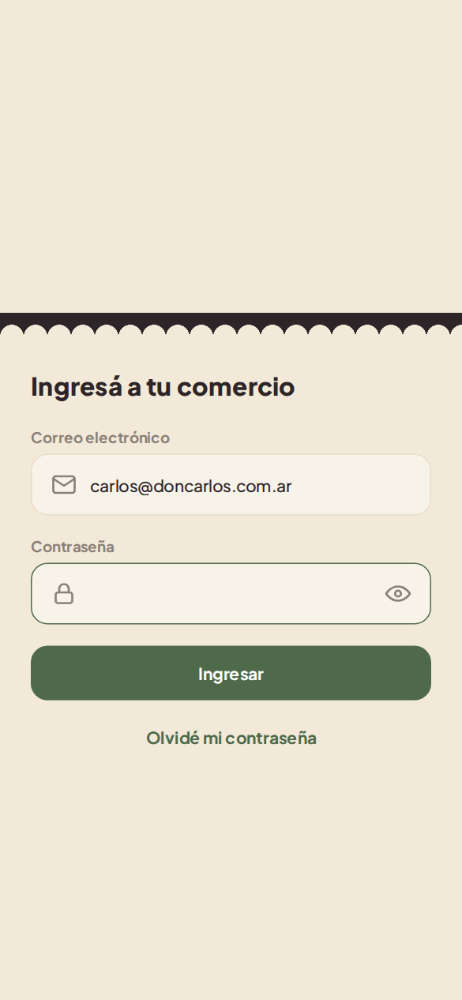

1. Escribí tu correo electrónico y tu contraseña. El correo no distingue mayúsculas.
2. Tocá **Ingresar**. El ojo del campo de contraseña la muestra u oculta.

Si los datos no son correctos aparece «Credenciales incorrectas». Un usuario desactivado tampoco puede ingresar: pedile al propietario que lo reactive. Las cuentas las crea el propietario (ver [Usuarios](#usuarios)).

### Cuenta y cierre de sesión

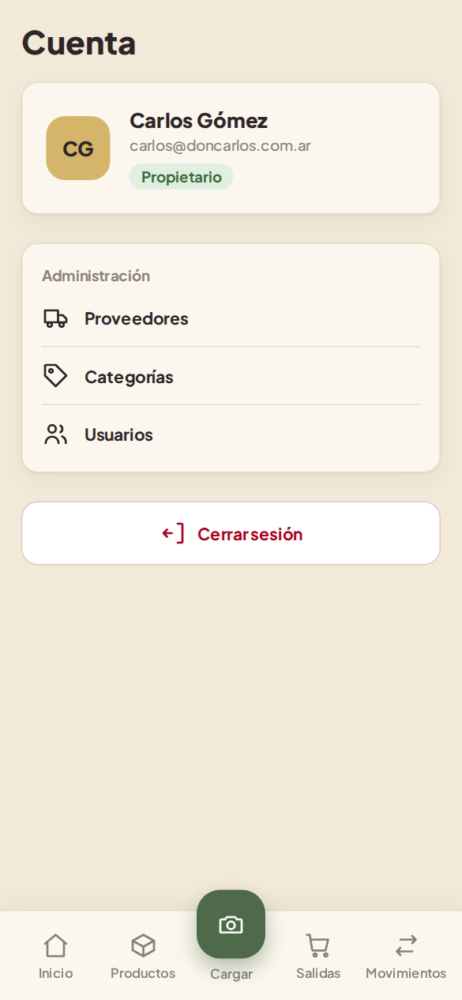

En el celular, tocá tus iniciales arriba a la derecha del Inicio para abrir **Cuenta**. Ahí ves tu nombre, tu correo y tu rol, y el botón **Cerrar sesión**. El propietario además encuentra los accesos de **Administración**: Proveedores, Categorías y Usuarios.

En la computadora, la sesión se cierra con el botón al lado de tu nombre, abajo del menú lateral.

### Instalar en el celular

Remitto es una aplicación web instalable (PWA). En Chrome para Android, abrí la dirección de Remitto, tocá el menú **⋮** y elegí **Instalar aplicación** (o **Agregar a la pantalla principal**). Queda un ícono como el de cualquier aplicación.

## 3. Cómo moverse por la aplicación

- **En el celular**, la barra inferior tiene **Inicio**, **Productos**, **Cargar** (el botón central, con la cámara), **Salidas** y **Movimientos**. El **Recuento** se abre desde Productos y la administración desde Cuenta.
- **En la computadora**, el menú lateral tiene todas las secciones. El propietario ve además el grupo **Configuración**.

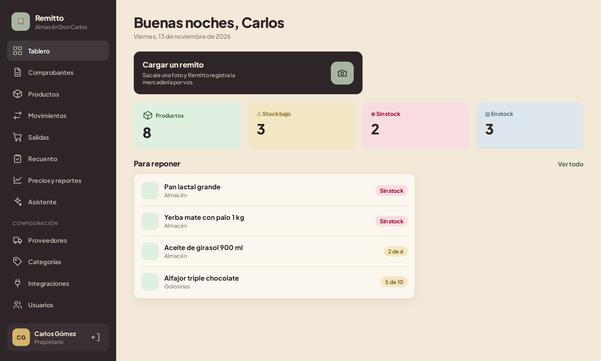

Algunas secciones del menú todavía muestran «En construcción»: **Precios y reportes**, **Asistente** e **Integraciones**. Se habilitan en las próximas versiones.

## 4. Inicio (tablero)

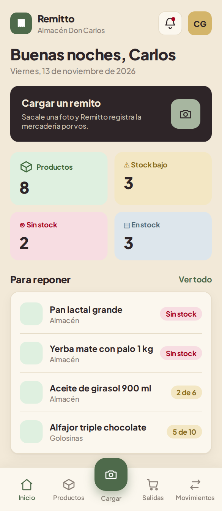

El Inicio muestra:

- el acceso rápido **Cargar un remito**;
- la cantidad de productos activos y cuántos están **en stock**, con **stock bajo** (en el mínimo o por debajo) y **sin stock**;
- **Para reponer**: los productos sin stock o con stock bajo, con su cantidad actual frente al mínimo. **Ver todo** abre Productos con el filtro de stock bajo.
- **Remitos por revisar**: los remitos leídos que esperan revisión; tocá uno para retomarlo. **Ver comprobantes** abre el archivo de comprobantes (ver [sección 5](#comprobantes-cargados)).

## 5. Ingresar mercadería con un remito

Es la operación principal. El stock **no cambia** hasta que alguien confirma el ingreso al final de la revisión.

### Paso 1: cargar el remito

| Antes de elegir el archivo | Con la vista previa |
| --- | --- |
| 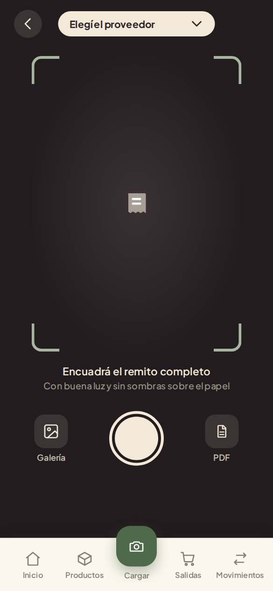 | 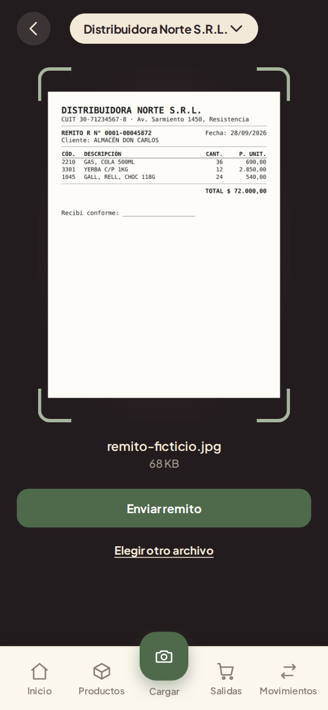 |

1. Tocá **Cargar** en la barra inferior o **Cargar un remito** en el Inicio.
2. Arriba, elegí el **proveedor**. Solo aparecen los proveedores activos.
3. Sacá la foto con el botón de la cámara, o elegí una imagen de la galería o un PDF. Para una buena lectura: el remito completo en el cuadro, con buena luz y sin sombras.
4. Revisá la vista previa y tocá **Enviar remito**.

Se aceptan fotos JPG, PNG, WEBP o HEIC y archivos PDF. Las fotos se achican antes de enviarlas para que la carga sea rápida.

### Paso 2: lectura con IA

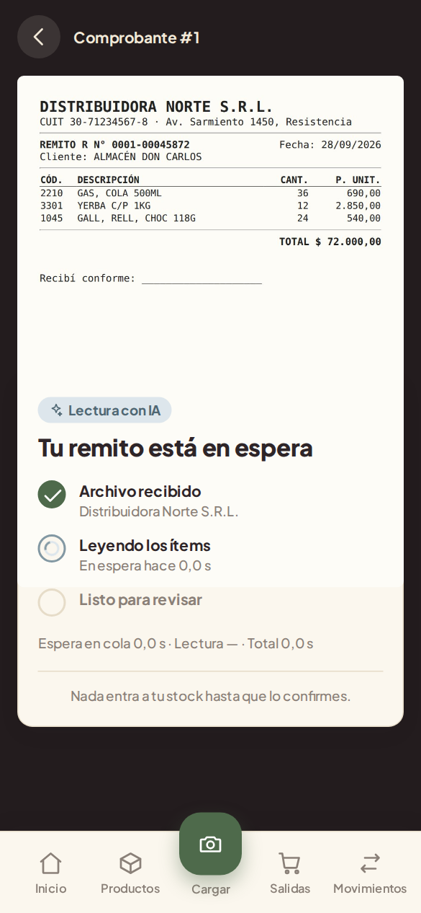

La lectura empieza sola y muestra sus etapas: **Archivo recibido**, **Leyendo los ítems** y **Listo para revisar**. Suele tardar unos segundos. Al terminar aparecen los datos leídos y el botón **Revisar remito**.

Si la lectura falla (por ejemplo, porque el servicio de IA no está disponible), aparece **No pudimos leer el remito** con la opción **Reintentar**. El remito queda guardado.

### Paso 3: revisar

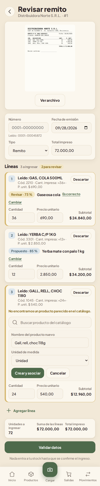

La revisión muestra el archivo original (**Ver archivo** lo abre en grande), los datos del encabezado y cada línea leída. En la computadora se ven lado a lado:

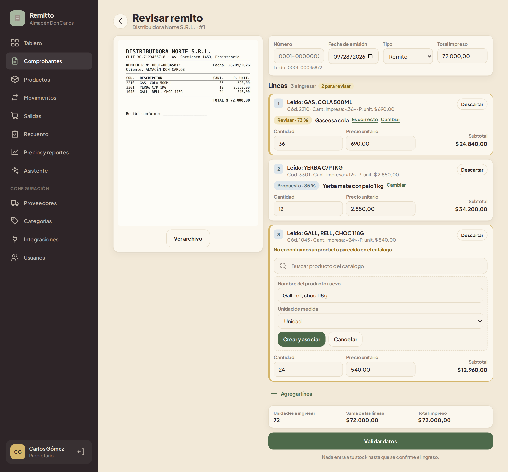

**Encabezado.** Completá el **Número** del comprobante: debajo se muestra el número leído como referencia («Leído: 0001-00045872»). El número es obligatorio y sirve para que un mismo remito no se ingrese dos veces. Revisá también la fecha de emisión, el tipo (remito, factura u otro) y el total impreso.

**Líneas.** Cada línea muestra lo que se leyó («Leído: GAS, COLA 500ML», con su código, cantidad y precio impresos) y el producto del catálogo asociado:

| Indicador | Significa | Qué hacer |
| --- | --- | --- |
| **Propuesto · 85 %** (celeste) | Remitto encontró el producto con seguridad | Nada, salvo que no sea el correcto |
| **Revisar · 73 %** (dorado, línea destacada) | Encontró un producto parecido, pero no está seguro: otra variante, otra marca o una descripción incompleta | Tocá **Es correcto** si lo es, o **Cambiar** para elegir otro |
| «No encontramos un producto parecido en el catálogo» | No hay coincidencia | Buscá el producto o, si es nuevo, dalo de alta |
| **Asociado** (verde) | Lo eligió una persona | — |

- **Cambiar** abre un buscador del catálogo para elegir otro producto.
- **Producto nuevo:** cuando no hay coincidencia, al propietario se le abre el formulario con un nombre sugerido. Corregí el nombre, elegí la unidad de medida y tocá **Crear y asociar**. El empleado puede buscar otro producto o pedirle al propietario que lo cree.
- Corregí la **cantidad** y el **precio unitario** si la lectura se equivocó. El subtotal se recalcula.
- **Descartar** saca una línea del ingreso (por ejemplo, un renglón que no es mercadería); **Restaurar** la vuelve a incluir.
- **Agregar línea** suma un producto que la lectura no encontró.

Los cambios se guardan solos («Guardado»): podés salir y retomar la revisión más tarde.

**Remitos escritos a mano o con mala foto.** Si Remitto detecta que el remito está escrito a mano, que la foto es de baja calidad o que no se lee bien, aparece el aviso **Revisión línea por línea obligatoria** con la cuenta de líneas revisadas. Compará cada línea con el original y tocá **Marcar como revisada** (si te equivocaste, **deshacer**). Las líneas que faltan quedan destacadas, y el ingreso no se puede confirmar hasta revisarlas todas. Las líneas descartadas no hace falta marcarlas y las que agregás a mano ya cuentan como revisadas.

### Paso 4: validar y confirmar

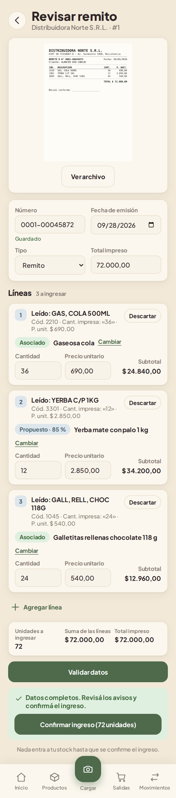

1. Tocá **Validar datos**. Si falta algo (el número, un producto, una cantidad), aparece la lista **Faltan datos para confirmar** con lo que hay que corregir. Las líneas dudosas generan un aviso, pero no impiden confirmar.
2. Con los datos completos aparece **Confirmar ingreso (N unidades)**. Al tocarlo, el stock de todos los productos se actualiza en una sola operación.

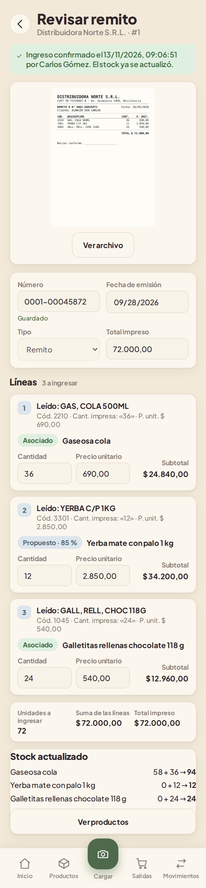

Arriba queda la constancia de quién confirmó y cuándo, y al pie el detalle **Stock actualizado** (por ejemplo «58 + 36 → 94»). Un remito confirmado ya no se puede modificar ni volver a ingresar.

### Comprobantes cargados

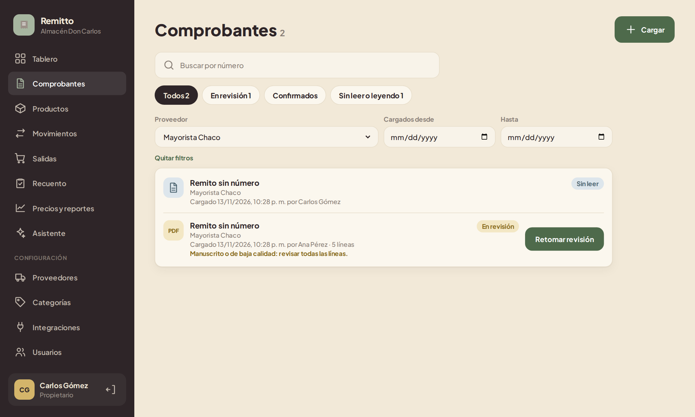

**Comprobantes** (en el menú lateral, o **Ver comprobantes** desde el Inicio o la ficha de un proveedor) guarda todos los remitos y facturas cargados, del más reciente al más antiguo. Cada uno muestra su estado (**Sin leer**, **Leyendo**, **En revisión**, **Confirmado** o **Error de lectura**), el proveedor, la fecha de emisión, quién lo cargó y cuándo, y el total.

- Filtrá por estado con los botones de arriba (indican cuántos hay de cada uno), por proveedor, por fecha de carga o buscando por número.
- **Retomar revisión** abre un remito que quedó a medio revisar, con lo ya corregido.
- Un remito **confirmado** se abre en modo consulta: el archivo original junto a las líneas ingresadas.
- Uno sin leer o con error abre la lectura con IA, donde se puede reintentar.

## 6. Productos

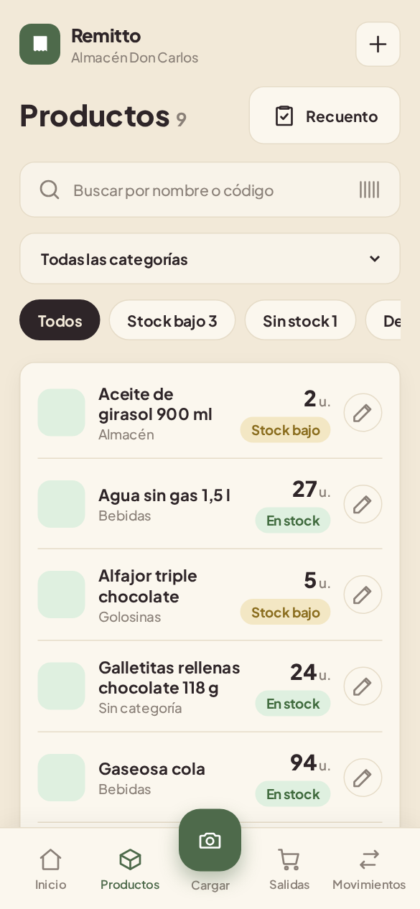

- Buscá por nombre o código de barras. Filtrá por categoría y por estado: **Todos**, **Stock bajo** o **Sin stock**.
- Cada producto muestra su categoría, su stock y su estado. Tocalo para ver su historial de **Movimientos**.
- **Recuento** abre el recuento de stock (ver [sección 9](#9-recuento-de-stock)).

### Alta y edición (propietario)

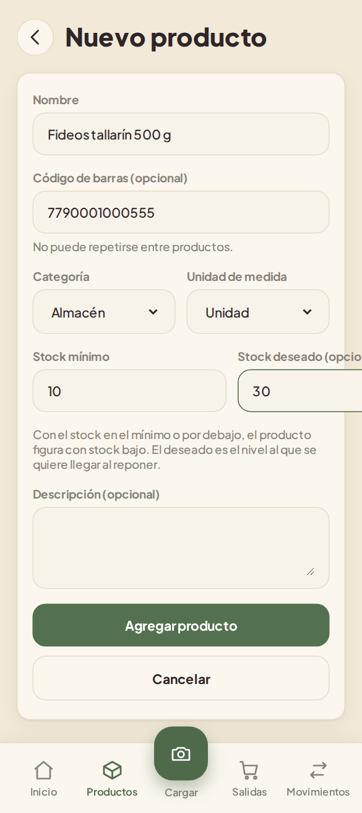

- **Alta:** el **+** de arriba (celular) o **Nuevo producto** (computadora).
- **Edición:** el lápiz al lado de cada producto.
- Datos: nombre, código de barras (opcional, no puede repetirse), categoría, unidad de medida, **stock mínimo** (con el stock en el mínimo o por debajo, el producto figura con stock bajo), **stock deseado** (el nivel al que se quiere llegar al reponer) y descripción.
- El **stock actual no se edita**: cambia solo con ingresos, salidas y recuentos.
- La unidad de medida no se puede cambiar si el producto ya tiene movimientos.
- **Desactivar producto:** un producto no se borra; se desactiva. Conserva su historial, pero deja de aparecer en las búsquedas, las salidas y los recuentos. El filtro **Desactivados** los muestra para **reactivarlos**.

## 7. Movimientos

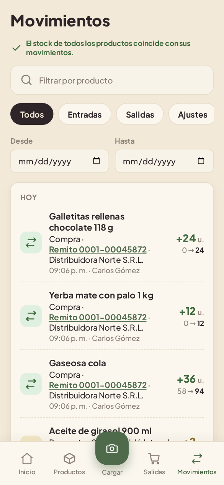

Es el historial de todo lo que cambió el stock, del más reciente al más antiguo:

- **Entradas** (verde): ingresos por remito, con un enlace al comprobante.
- **Salidas**: ventas, consumo interno, roturas, vencimientos y otros.
- **Ajustes**: recuentos.

Cada movimiento muestra la cantidad, el stock antes y después (por ejemplo «58 → 94»), la hora y quién lo registró. Se puede filtrar por producto, por tipo y por fechas (**Desde** y **Hasta**).

Arriba, el aviso «El stock de todos los productos coincide con sus movimientos» confirma que no hay diferencias entre el stock y su historial.

## 8. Registrar una salida

| Carrito armado | Salida registrada |
| --- | --- |
| 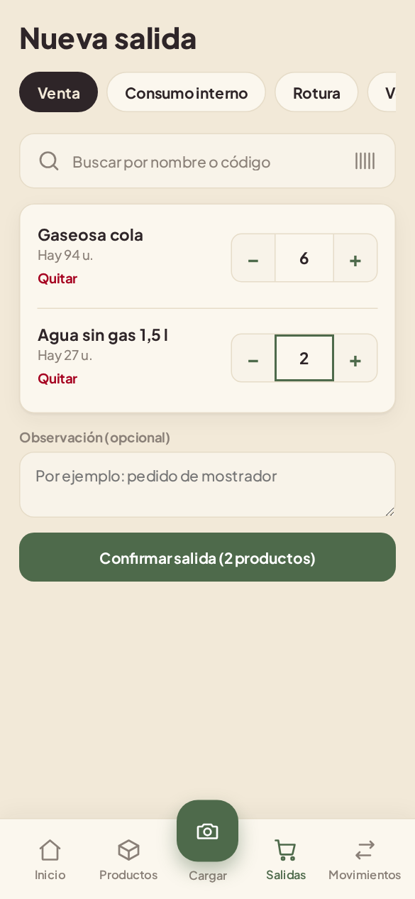 | 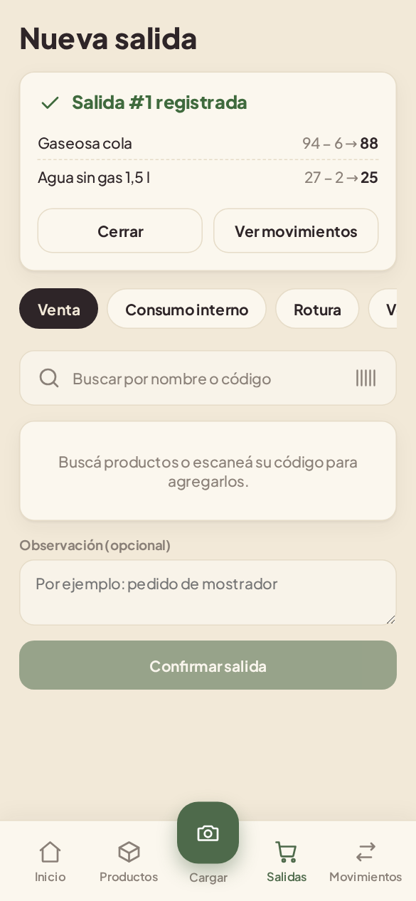 |

1. Abrí **Salidas**.
2. Elegí el motivo: **Venta**, **Consumo interno**, **Rotura**, **Vencimiento** u **Otro**. Con «Otro», la observación es obligatoria.
3. Buscá los productos por nombre o código y tocálos para agregarlos. Los que no tienen stock aparecen deshabilitados.
4. Ajustá las cantidades con **−** y **+** o escribiéndolas. Las unidades y los paquetes van enteros; los kilos y litros admiten hasta 3 decimales (con coma: 1,5).
5. Tocá **Confirmar salida**.

El resumen muestra el stock de cada producto antes y después (por ejemplo «94 − 6 → 88»). Si la conexión falla y se reintenta, la salida no se descuenta dos veces: aparece «Ya se había registrado: no se descontó de nuevo».

## 9. Recuento de stock

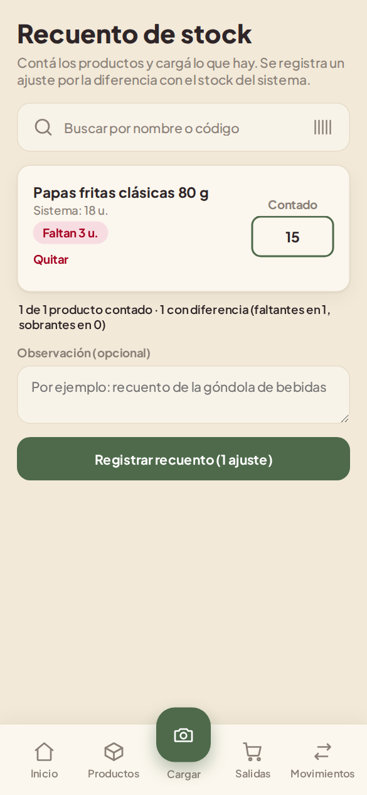

Sirve para corregir el stock después de contar la mercadería en el local.

1. Abrí **Recuento** (desde Productos en el celular, o desde el menú lateral).
2. Buscá cada producto que contaste y escribí la **cantidad contada** (0 si no hay).
3. La pantalla muestra en el momento la diferencia con el stock del sistema («Faltan 3» o «Sobran 2») y un resumen.
4. Tocá **Registrar recuento**. Se registra un ajuste por cada producto con diferencia; los que coinciden no generan movimiento.

Si mientras contabas hubo una venta o un ingreso de alguno de esos productos, Remitto avisa y no ajusta ninguno: la pantalla toma el stock nuevo para que revises el conteo y vuelvas a confirmar.

## 10. Administración (solo propietario)

Se abre desde **Configuración** en el menú lateral (computadora) o desde **Cuenta** (celular). El empleado no puede entrar a estas pantallas.

### Proveedores

| Lista | Proveedor nuevo |
| --- | --- |
| 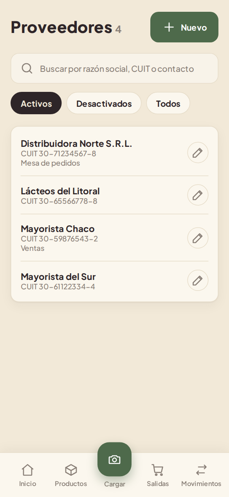 | 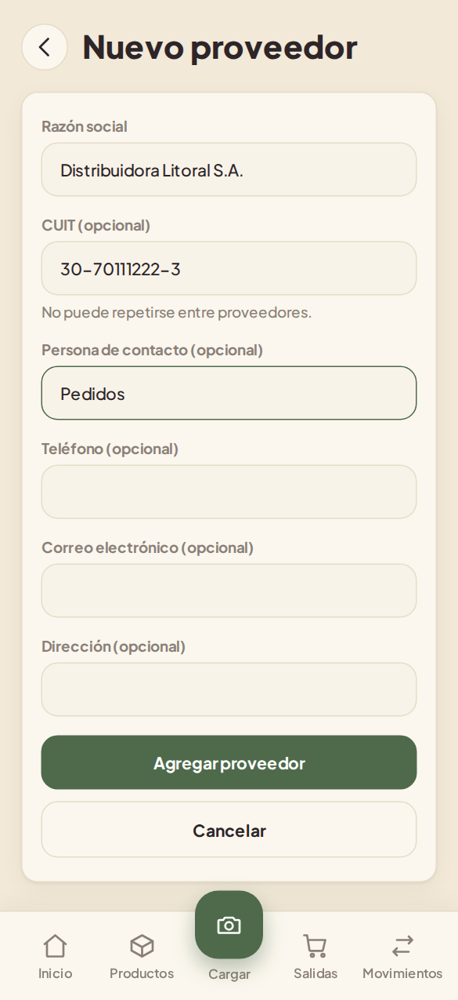 |

- Buscá por razón social, CUIT o contacto, y filtrá por **Activos**, **Desactivados** o **Todos**.
- **Nuevo** abre el alta; tocá un proveedor para editarlo.
- Datos: razón social (obligatoria), CUIT (opcional, con o sin guiones, no puede repetirse), contacto, teléfono, correo y dirección.
- **Desactivar proveedor:** no se borra; conserva sus comprobantes, pero deja de aparecer al cargar un remito. Se puede reactivar.

### Categorías

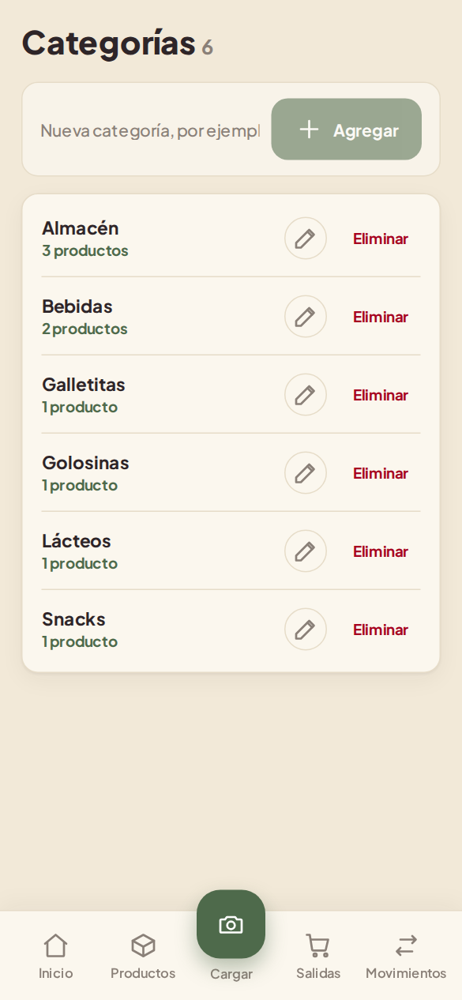

- Escribí el nombre y tocá **Agregar**. No puede repetirse, aunque cambien las mayúsculas.
- El lápiz cambia el nombre; **Eliminar** la borra. Sus productos quedan **sin categoría** (no se borra ninguno).
- La cantidad de productos de cada categoría abre Productos filtrado por esa categoría.

### Usuarios

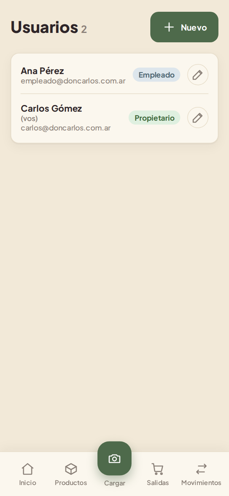

- La lista muestra a cada persona con su rol; «(vos)» marca tu propia cuenta.
- **Nuevo** crea un usuario con nombre, correo, rol y contraseña (al menos 6 caracteres). Pasale la contraseña por un medio seguro.
- Al editar, la contraseña se puede dejar vacía para no cambiarla, o completar para asignar una nueva si la persona la olvidó.
- **Desactivar usuario:** no puede volver a ingresar y, si tenía una sesión abierta, deja de funcionar en su siguiente acción. Lo que registró se conserva. Se puede reactivar.
- En tus propios datos no podés quitarte el rol de propietario ni desactivarte, para que el comercio nunca quede sin administrador.

## 11. Preguntas frecuentes y mensajes

**¿Por qué no cambió el stock después de leer un remito?**
La lectura es solo una propuesta. El stock cambia recién con **Confirmar ingreso**.

**«Este remito ya se ingresó»**
Ya hay un comprobante confirmado del mismo proveedor con ese número. Revisá el número o buscá el remito anterior en Movimientos.

**«Número no válido. Usá coma para los decimales»**
Las cantidades y precios se escriben en formato argentino: «1,5» o «1.250,50».

**«Se cuenta en unidades enteras»**
El producto se mide en unidades o paquetes: no admite decimales.

**«No hay stock»**
No se puede registrar una salida mayor al stock disponible.

**«Esta acción es solo para el propietario»**
La función requiere el rol de propietario.

**«Sesión inválida o expirada» o «Usuario inexistente o desactivado»**
Volvé a iniciar sesión. Si el problema sigue, el propietario tiene que revisar tu usuario.

**Un producto no aparece en la búsqueda**
Puede estar desactivado: el propietario lo ve con el filtro **Desactivados** y lo puede reactivar.

---

## Notas para el equipo (no forman parte del manual entregado)

- Las capturas se tomaron el 13/11/2026 contra una base descartable con el seed y `IA_SIMULACION=ok`, con Chromium sin interfaz (390 px de ancho y 1366 px en escritorio). En la preparación, «Gaseosa cola 500 ml» se renombró a «Gaseosa cola» y se desactivó la galletita del seed, para mostrar una línea dudosa y una sin coincidencia.
- Los campos de fecha aparecen en formato mm/dd/aaaa porque el navegador de las capturas estaba en inglés; en un celular en castellano se ven como dd/mm/aaaa.
- La campana del Inicio todavía no tiene función (las alertas son de HU24).
- La sección de instalación describe el procedimiento estándar de Chrome; la instalación en un Android real todavía no se probó (HU7).
- Al implementar más historias, agregar sus secciones (Comprobantes, Precios y reportes, Asistente, Integraciones) y actualizar la lista de «En construcción».
