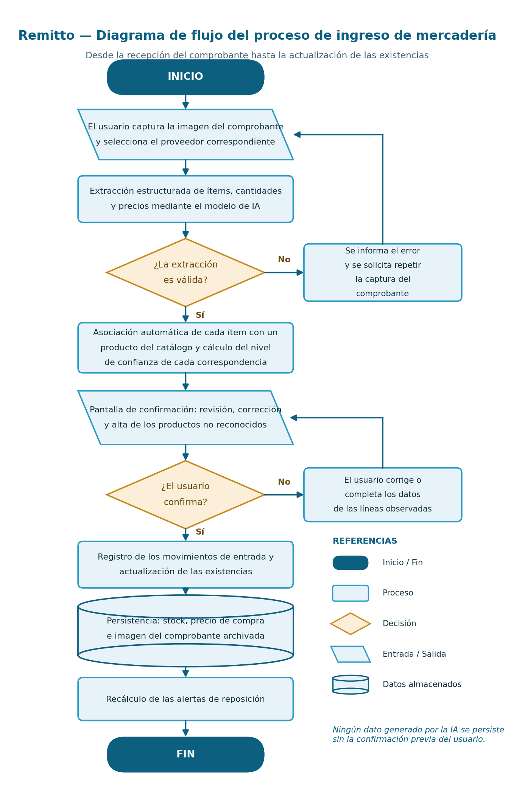
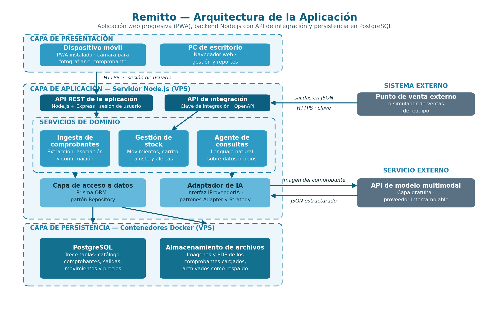

# Plan de trabajo de Remitto para desarrollo

Referencia de alcance derivada del documento académico `Plan_de_Trabajo_TFI_Remitto.docx`, provisto por el equipo. Conserva la descripción del producto, el alcance, los requerimientos funcionales y no funcionales, la arquitectura propuesta, las tecnologías, el reparto previsto, las 31 historias con sus tareas y criterios de aceptación (texto literal del plan) y un resumen del proceso previsto.

Este extracto omite DNI, legajos, firmas, Gantt/PERT, áreas de conocimiento y aportes personales. No sustituye el documento académico original. Los responsables, puntos y sprints son los previstos en ese plan; no fijan la autoría real ni prueban qué se implementó. Los estados originales «To Do» se omiten para evitar confundirlos con el avance actual.

Para el avance, consultar [estado del proyecto](estado-proyecto.md) y verificar la rama, el código y los PR actuales. El diseño de referencia está en [maquetación](maquetacion.md). Si hay una diferencia de alcance, informarla y resolverla con el equipo; no convertir automáticamente la diferencia en una tarea nueva.

## Título del proyecto

Remitto – Sistema de gestión de stock para comercios minoristas de cercanía, con carga automática de comprobantes de compra mediante Inteligencia Artificial.

## Breve descripción de la organización

Al tratarse de un proyecto de inventiva propia, no se trabaja con una organización contratante en particular, sino con un tipo de organización destinataria bien definido, que determina los requerimientos, las restricciones de diseño y el mercado al que se orienta el producto.

La organización destinataria es el comercio minorista de cercanía: kioscos, almacenes, despensas y autoservicios de barrio. Se trata de comercios de pequeño tamaño, en su mayoría familiares, con las siguientes características relevantes para el proyecto:

- Entre una y cinco personas trabajando, donde el propietario concentra la atención al público, la compra a proveedores y el control de la mercadería.

- Un catálogo de entre trescientos y mil quinientos productos, con alta rotación y reposición semanal o quincenal.

- Entre cinco y quince proveedores habituales, cada uno con su propio formato de remito o factura, entregado en papel al momento de la descarga.

- No utilizan un sistema informático de gestión, o emplean planillas de cálculo que se desactualizan rápidamente.

- No cuentan con personal técnico y disponen de un presupuesto reducido, por lo que necesitan una solución de bajo costo, sin instalación compleja ni capacitación prolongada.

- El teléfono celular es el dispositivo principal de trabajo, disponible en el momento y el lugar en que la mercadería ingresa al comercio.

## Antecedentes y descripción del proyecto

### Enunciado del problema

El problema central que aborda este proyecto no es la falta de sistemas de gestión de stock, sino el tiempo y el trabajo que demanda cargar los datos en ellos. Existe en el mercado una amplia oferta de software de inventario, gratuito y pago; sin embargo, la cantidad de comercios que lo abandonan es elevada, y la causa principal es el esfuerzo que exige mantener la información actualizada.

El proveedor entrega la mercadería junto con un remito en papel, en el momento de la descarga y por lo general con poco tiempo disponible. Registrar ese comprobante implica transcribir manualmente entre veinte y cuarenta líneas, indicando producto, cantidad y precio unitario. Como la tarea es extensa y no puede realizarse mientras se atiende al público, se pospone; al posponerse, se acumula; y cuando se acumula demasiado, el sistema se abandona y el comercio regresa al control por memoria.

Las consecuencias de esta situación son concretas:

- Quiebres de stock en los productos de mayor rotación, con la consiguiente pérdida de ventas.

- Sobrecompra de productos de baja rotación, con capital inmovilizado en mercadería que no se vende.

- No queda registro de los precios de compra anteriores, lo que impide detectar aumentos y comparar proveedores.

- No es posible conocer la diferencia entre el stock registrado y el stock real, ni detectar faltantes, roturas o vencimientos.

- Las decisiones de reposición dependen únicamente de la memoria del propietario y no pueden delegarse.

### Enunciado de la solución

Remitto es una aplicación web progresiva (PWA) de gestión de stock, instalable en el teléfono celular y accesible también desde una computadora de escritorio, cuya característica distintiva es la carga automática de los comprobantes de compra mediante Inteligencia Artificial.

El flujo de ingreso de mercadería es el siguiente:

- El usuario fotografía el remito con la cámara del celular, o carga el archivo PDF, e indica el proveedor.

- El sistema extrae de forma estructurada los ítems detectados: código, descripción, cantidad y precio unitario.

- Cada ítem se asocia automáticamente a un producto del catálogo, con el nivel de confianza de la asociación.

- El usuario revisa la propuesta, corrige lo que corresponda, da de alta los productos nuevos y confirma. Ningún dato generado por la Inteligencia Artificial se registra sin validación humana previa.

- Se registran los movimientos de entrada, se actualizan las existencias, se guarda el precio de compra y se archiva la imagen del comprobante.

- El sistema recalcula las alertas de reposición.

Para que las existencias registradas se mantengan cercanas a las reales, el sistema también necesita conocer las salidas de mercadería. Como Remitto no incluye un punto de venta, las salidas se registran por dos vías: un carrito de salida, que permite descontar varios productos en una sola operación desde la aplicación, y un endpoint de integración, a través del cual un sistema externo de punto de venta puede informar las salidas de forma automática. En ambos casos las salidas se registran únicamente en unidades, sin precios de venta.

### Funcionalidades del sistema

- Administración de productos, categorías, proveedores y usuarios, con control de acceso por roles (propietario y empleado).

- Ingesta de comprobantes por imagen o PDF, con extracción automática, asociación al catálogo y confirmación del usuario.

- Registro de movimientos de stock diferenciados por tipo: entradas por comprobante, salidas y ajustes por recuento.

- Carrito de salida, que descuenta varios productos en una sola operación e indica el motivo (venta, consumo interno, rotura o vencimiento).

- Endpoint de integración protegido con clave de acceso, que permite a un punto de venta externo informar salidas sin registrar dos veces la misma operación, acompañado de un simulador de ventas.

- Ajuste por recuento físico, que calcula y registra la diferencia contra el stock registrado.

- Historial de precios de compra por producto y proveedor.

- Alertas de stock mínimo y sugerencia de reposición.

- Agente de consultas en lenguaje natural sobre los datos del comercio.

- Reportes de valorización de existencias, productos sin movimiento y evolución de precios.

- Archivo digital de los comprobantes cargados.

Como funcionalidades deseables, sujetas a disponibilidad de tiempo, se prevén la lectura de códigos de barras en el carrito de salida y la exportación de la sugerencia de reposición como orden de compra.

El siguiente diagrama representa el proceso de ingreso de mercadería, que constituye la operación central del sistema, con las dos instancias de validación por parte del usuario previas a todo registro definitivo.

Figura 1. Diagrama de flujo del proceso de ingreso de mercadería.

### Alcance y limitaciones

- Queda fuera del alcance un punto de venta completo, es decir, caja, emisión de comprobantes fiscales y gestión de medios de pago. Las ventas se registran solo como salidas de stock en unidades. El punto de venta se considera un módulo de ampliación futura, para el cual el modelo de datos ya se encuentra preparado.

- El endpoint de integración define el contrato que debe respetar un sistema externo, pero no incluye la conexión con un producto comercial en particular. Su funcionamiento se valida con el simulador de ventas del equipo.

- El sistema se diseña para un solo comercio, con varios usuarios y roles.

- La extracción automática está pensada para comprobantes impresos. Los comprobantes escritos a mano igualmente se procesan, pero el sistema avisa que requieren una revisión más cuidadosa y solicita la confirmación de todas las líneas.

### Enunciado de los requerimientos

Los requerimientos se organizan en funcionales, no funcionales y técnicos. Cada requerimiento funcional agrupa subrequerimientos verificables, que dan origen a las historias de usuario del backlog.

### Requerimientos funcionales

| ID | Requerimiento | Subrequerimientos | Prioridad | Responsable |
| --- | --- | --- | --- | --- |
| RF1 | Usuarios y acceso | Iniciar sesión (RF1.1), acceder solo a las funciones del rol (RF1.2) y administrar usuarios (RF1.3). | Mandatoria | Jara |
| RF2 | Catálogo | Administrar productos con stock mínimo y deseado (RF2.1), categorías (RF2.2) y proveedores (RF2.3). | Mandatoria | Jara |
| RF3 | Ingesta de comprobantes | Cargar un comprobante por foto o PDF (RF3.1), extraer los ítems con IA (RF3.2), asociarlos al catálogo con nivel de confianza (RF3.3), revisar y confirmar con alta de productos nuevos (RF3.4), reconocer equivalencias por proveedor (RF3.5), exigir revisión completa en comprobantes dudosos (RF3.6), consultar los comprobantes archivados (RF3.7) y medir la precisión de la extracción (RF3.8). | Mandatoria | Sanchez |
| RF4 | Gestión de stock | Registrar las entradas de un comprobante confirmado (RF4.1), consultar existencias y movimientos (RF4.2), registrar salidas con el carrito (RF4.3) y ajustar el stock por recuento (RF4.4). | Mandatoria | Stabile |
| RF5 | Integración con sistemas externos | Administrar claves de integración (RF5.1), recibir salidas por el endpoint sin duplicados y con contrato OpenAPI (RF5.2) y validar la integración con un simulador de ventas (RF5.3). | Mandatoria | Stabile |
| RF6 | Alertas y reposición | Generar alertas de stock bajo, sin stock y negativo (RF6.1) y sugerir la reposición (RF6.2). | Mandatoria | Stabile y Jara |
| RF7 | Agente de consultas | Responder preguntas en lenguaje natural sobre los datos del comercio y registrar cada consulta (RF7.1). | Mandatoria | Jara |
| RF8 | Reportes | Valorización de existencias (RF8.1), productos sin movimiento (RF8.2), evolución de precios de compra (RF8.3) y tablero de situación (RF8.4). | Mandatoria | Jara y Sanchez |
| RF9 | Funcionalidades deseables | Lectura de códigos de barras en el carrito (RF9.1) y exportación de la sugerencia como orden de compra (RF9.2). | Deseable | Stabile y Jara |

### Requerimientos no funcionales

| ID | Tipo | Especificación |
| --- | --- | --- |
| RNF1 | Seguridad | Las funciones requieren sesión autenticada y conexión HTTPS. Las contraseñas y las claves de integración se almacenan como hash, y la credencial del servicio de IA reside solo en el servidor. |
| RNF2 | Rendimiento | Las consultas habituales responden en un máximo de tres segundos, y la extracción de un comprobante no supera los treinta segundos. |
| RNF3 | Usabilidad | El registro de un comprobante de veinte líneas se completa en menos de tres minutos. Las líneas de baja confianza y los errores de validación se indican con claridad. |
| RNF4 | Compatibilidad | La aplicación se instala como PWA en celulares Android y se utiliza desde navegadores de escritorio sin perder funciones. |
| RNF5 | Integridad | Las reglas de negocio principales se aplican en la base de datos mediante restricciones, y el stock se actualiza en la misma transacción que el movimiento que lo modifica. |
| RNF6 | Mantenibilidad | El proveedor de IA puede reemplazarse modificando solo su adaptador, y el sistema se despliega mediante contenedores Docker. |

### Arquitectura de la información

La información se organiza en trece tablas, cuyo esquema completo, con atributos, relaciones y restricciones, se presenta como documento complementario de esta instancia:

- Usuarios y claves de integración: personas que operan el sistema, con su rol, y credenciales de los sistemas externos autorizados a informar salidas.

- Productos, categorías y proveedores: catálogo del comercio, con stock actual, mínimo y deseado, y datos de quienes le venden mercadería.

- Códigos de proveedor: equivalencias entre la forma en que cada proveedor nombra un producto y el producto del catálogo.

- Comprobantes y detalles de comprobante: documento recibido y cada una de sus líneas, con los datos leídos por la IA y los confirmados por el usuario en columnas separadas.

- Salidas: operación que agrupa los movimientos registrados juntos, desde el carrito o desde la integración.

- Movimientos de stock: entidad central del modelo. El stock de cada producto se calcula a partir de sus movimientos de entrada, salida y ajuste.

- Precios de compra, alertas de stock y consultas al agente: historial de precios por proveedor, alertas de reposición con su historia y registro de cada pregunta al agente.

La navegación se organiza en cuatro áreas: el tablero de situación; el ingreso de mercadería; las existencias y movimientos, que incluye el carrito de salida; y las consultas y reportes. Se prioriza el acceso desde el celular al ingreso de mercadería y al carrito, por ser las tareas que se realizan fuera del escritorio.

### Arquitectura de software

Se adopta una arquitectura cliente-servidor en capas, con separación de responsabilidades:

- Capa de presentación: aplicación web progresiva en React, responsiva e instalable, con una única base de código para el uso móvil y de escritorio.

- Capa de aplicación: servidor Node.js con Express, que publica una API REST y concentra la lógica en servicios de dominio: ingesta de comprobantes, gestión de stock y agente de consultas.

- API de integración: rutas destinadas a sistemas externos, autenticadas con clave de integración y documentadas con OpenAPI. Las salidas que recibe se procesan con el mismo servicio de stock que usa el carrito.

- Capa de acceso a datos: implementada con Prisma, que separa la lógica de negocio de los detalles del almacenamiento.

- Capa de persistencia: PostgreSQL y almacenamiento de archivos, en contenedores Docker sobre un servidor virtual privado.

- Servicio externo: API del modelo de Inteligencia Artificial, consumida solo desde el servidor.

Figura 2. Arquitectura en capas de la aplicación Remitto.

### Patrones de diseño

- Repository: los servicios de dominio trabajan contra una interfaz de repositorio y no conocen los detalles del almacenamiento, lo que facilita probarlos y limita el impacto de los cambios en el modelo de datos.

- Adapter: el proveedor de IA se consume a través de una interfaz propia, de modo que un cambio de servicio afecta solo al adaptador. El mismo criterio se aplica a los puntos de venta que se conecten en el futuro.

- Strategy: permite elegir durante la ejecución la forma de extracción según el tipo de documento (fotografía, PDF digital o imagen de baja calidad), sin modificar el servicio de ingesta.

- Observer: cada movimiento de stock notifica a los componentes interesados, que recalculan las alertas de reposición sin que el módulo de movimientos dependa del de alertas. Incluye las salidas informadas por la integración.

### Incorporación de Inteligencia Artificial

Módulo 1: extracción estructurada de comprobantes. Un modelo multimodal recibe la imagen o el PDF del comprobante y devuelve una representación en formato JSON, validada contra un esquema definido por el equipo.

Módulo 2: agente de consultas en lenguaje natural. El usuario formula preguntas en castellano sobre existencias, salidas, reposición o precios. El agente las traduce a operaciones sobre la base mediante un conjunto acotado de herramientas y devuelve la respuesta con la tabla o el gráfico correspondiente.

Justificación. Ninguno de los dos módulos puede resolverse con reglas fijas: cada proveedor usa un formato distinto, con abreviaturas propias y fotografías tomadas en condiciones variables, y las preguntas libres de un usuario sin conocimientos técnicos no se pueden prever con reportes predefinidos. Se prevé un modelo con capa gratuita de acceso; como sus condiciones cambian con cierta frecuencia, el patrón Adapter permite reemplazar el proveedor sin afectar el resto del desarrollo.

### Enunciado de la tecnología a utilizar

| Tecnología | Nombre | Función |
| --- | --- | --- |
| Backend | Node.js + Express | API REST, lógica de negocio, coordinación de los servicios de IA y endpoint de integración. |
| Frontend | React (PWA) | Interfaz responsiva e instalable, con acceso a la cámara para capturar el comprobante. |
| Gestor de Base de Datos | PostgreSQL | Persistencia de catálogo, comprobantes, salidas, movimientos de stock e historial de precios. |
| ORM | Prisma | Mapeo objeto-relacional, migraciones y consultas tipadas; soporte del patrón Repository. |
| Maquetación | Figma | Wireframes y prototipo navegable de la interfaz. |
| Gestión y Organización de Proyectos | GitHub | Repositorio del código, registro de versiones y registro de incidencias. |
|  | Trello | Tablero Kanban general del proyecto y un tablero por integrante. |
| Inteligencia Artificial | API de modelo multimodal con capa gratuita | Extracción estructurada de comprobantes y agente de consultas. |
| Otras tecnologías | OpenAPI (Swagger) | Documentación del contrato del endpoint de integración. |
|  | Docker sobre VPS | Contenedores de la base de datos y el backend en el servidor de producción. |
|  | Google Drive y Discord | Documentación compartida y comunicación del equipo. |

### Conformación del equipo

| Apellido y Nombre | Módulo a desarrollar |
| --- | --- |
| Jara, Agostina | **Base y consultas.** Autenticación y roles, catálogo de productos, categorías y proveedores, instalación como PWA, agente de consultas en lenguaje natural, tablero de situación y reportes. |
| Sanchez, Ivan | **Ingesta con IA.** Carga del comprobante, extracción estructurada con el modelo de IA, asociación al catálogo, pantalla de confirmación, equivalencias por proveedor, medición de la precisión y evolución de precios de compra. |
| Stabile, Maximiliano | **Stock e integración.** Movimientos de stock, carrito de salida, ajuste por recuento, alertas de reposición, claves de integración, endpoint de integración y simulador de ventas. |

## Backlog previsto

La épica del plan es: «Como comerciante, quiero que la mercadería que entra y sale de mi comercio quede registrada sin transcribir comprobantes a mano, para conocer en todo momento mi stock real y decidir qué reponer».

El alcance obligatorio comprende HU1 a HU29 (100 puntos: 48 en el Sprint 1 y 52 en el Sprint 2). HU30 y HU31 son deseables y dependen de la disponibilidad de tiempo. En el Sprint 1 la asociación de cada línea con el catálogo es manual, en la pantalla de revisión; la asociación automática se especifica en HU15.

### Índice de historias

| ID | Req. | Historia de usuario | Prior. | Pts. | Responsable | Sprint |
| --- | --- | --- | --- | --- | --- | --- |
| HU1 | RF1.1 | Iniciar sesión | Alta | 3 | Jara | 1 |
| HU2 | RF1.2 | Acceder solo a las funciones del rol | Alta | 3 | Jara | 1 |
| HU3 | RF1.3 | Administrar usuarios | Media | 2 | Jara | 1 |
| HU4 | RF2.1 | Administrar productos | Alta | 3 | Jara | 1 |
| HU5 | RF2.2 | Administrar categorías | Media | 1 | Jara | 1 |
| HU6 | RF2.3 | Administrar proveedores | Alta | 2 | Jara | 1 |
| HU7 | RNF4 | Instalar la aplicación en el celular | Alta | 2 | Jara | 1 |
| HU8 | RF3.1 | Cargar un comprobante | Alta | 3 | Sanchez | 1 |
| HU9 | RF3.2 | Extraer los ítems del comprobante con IA | Alta | 8 | Sanchez | 1 |
| HU10 | RF3.4 | Revisar y confirmar un comprobante | Alta | 5 | Sanchez | 1 |
| HU11 | RF4.1 | Registrar las entradas de stock | Alta | 5 | Stabile | 1 |
| HU12 | RF4.2 | Consultar existencias y movimientos | Alta | 3 | Stabile | 1 |
| HU13 | RF4.3 | Registrar una salida con el carrito | Alta | 5 | Stabile | 1 |
| HU14 | RF4.4 | Ajustar el stock por recuento | Alta | 3 | Stabile | 1 |
| HU15 | RF3.3 | Asociar automáticamente los ítems al catálogo | Alta | 5 | Sanchez | 2 |
| HU16 | RF3.5 | Reconocer equivalencias por proveedor | Media | 3 | Sanchez | 2 |
| HU17 | RF3.6 | Exigir revisión completa en comprobantes dudosos | Media | 2 | Sanchez | 2 |
| HU18 | RF3.7 | Consultar los comprobantes archivados | Media | 2 | Sanchez | 2 |
| HU19 | RF3.8 | Medir la precisión de la extracción | Media | 3 | Sanchez | 2 |
| HU20 | RF8.3 | Consultar la evolución de los precios de compra | Media | 3 | Sanchez | 2 |
| HU21 | RF5.1 | Administrar las claves de integración | Alta | 3 | Stabile | 2 |
| HU22 | RF5.2 | Recibir salidas desde un sistema externo | Alta | 8 | Stabile | 2 |
| HU23 | RF5.3 | Simular ventas de un punto de venta | Alta | 3 | Stabile | 2 |
| HU24 | RF6.1 | Generar alertas de stock | Alta | 3 | Stabile | 2 |
| HU25 | RF7.1 | Consultar en lenguaje natural | Alta | 8 | Jara | 2 |
| HU26 | RF8.4 | Ver el tablero de situación | Media | 3 | Jara | 2 |
| HU27 | RF6.2 | Obtener la sugerencia de reposición | Media | 2 | Jara | 2 |
| HU28 | RF8.1 | Consultar la valorización de existencias | Media | 2 | Jara | 2 |
| HU29 | RF8.2 | Consultar productos sin movimiento | Media | 2 | Jara | 2 |
| HU30 | RF9.1 | Escanear el código de barras en el carrito | Deseable | 3 | Stabile | Sujeta a tiempo |
| HU31 | RF9.2 | Exportar la sugerencia como orden de compra | Deseable | 2 | Jara | Sujeta a tiempo |

### HU1 Iniciar sesión

Como usuario del comercio quiero iniciar sesión con mi correo y contraseña para acceder al sistema de forma segura.

Responsable: Jara · 3 pts.

Prioridad prevista: Alta.

**Tareas del plan**

1. Crear el modelo de usuarios con contraseña cifrada.
2. Implementar el endpoint de inicio de sesión con token.
3. Diseñar la pantalla de inicio de sesión.
4. Implementar el cierre de sesión.

**Criterios de aceptación**

- Un usuario activo con credenciales correctas ingresa al sistema.
- Las credenciales incorrectas muestran un mensaje de error.
- Un usuario desactivado no puede iniciar sesión.

### HU2 Acceder solo a las funciones del rol

Como propietario quiero que cada usuario acceda solo a las funciones de su rol para proteger la configuración del comercio.

Responsable: Jara · 3 pts.

Prioridad prevista: Alta.

**Tareas del plan**

1. Incluir el rol en el token de sesión.
2. Proteger las rutas del backend según el rol.
3. Ocultar en la interfaz las opciones no habilitadas.
4. Probar los permisos de ambos roles.

**Criterios de aceptación**

- El empleado no accede a la administración de usuarios ni de claves.
- Un pedido sin sesión válida recibe un error de autorización.
- El propietario accede a todas las funciones.

### HU3 Administrar usuarios

Como propietario quiero dar de alta, modificar y desactivar usuarios para controlar quién opera el sistema.

Responsable: Jara · 2 pts.

Prioridad prevista: Media.

**Tareas del plan**

1. Crear el listado de usuarios.
2. Implementar el alta y la modificación con correo único.
3. Implementar la desactivación.

**Criterios de aceptación**

- No se admiten dos usuarios con el mismo correo.
- Un usuario desactivado no puede iniciar sesión.

### HU4 Administrar productos

Como propietario quiero registrar, modificar y desactivar productos con su stock mínimo para mantener actualizado el catálogo.

Responsable: Jara · 3 pts.

Prioridad prevista: Alta.

**Tareas del plan**

1. Crear los endpoints del catálogo de productos.
2. Diseñar el listado con búsqueda por nombre y código.
3. Diseñar el formulario con unidad de medida, stock mínimo y stock deseado.
4. Implementar la desactivación.

**Criterios de aceptación**

- El código de barras, si se informa, no puede repetirse.
- Un producto con movimientos no se elimina: se desactiva.
- Los productos desactivados no aparecen en las búsquedas.

### HU5 Administrar categorías

Como propietario quiero administrar las categorías para agrupar los productos en la navegación y los reportes.

Responsable: Jara · 1 pts.

Prioridad prevista: Media.

**Tareas del plan**

1. Crear los endpoints de categorías.
2. Diseñar el listado y el formulario.
3. Validar los nombres duplicados.

**Criterios de aceptación**

- No se admiten dos categorías con el mismo nombre.
- Un producto puede quedar sin categoría.

### HU6 Administrar proveedores

Como propietario quiero registrar y modificar a mis proveedores para asociarles los comprobantes que envían.

Responsable: Jara · 2 pts.

Prioridad prevista: Alta.

**Tareas del plan**

1. Crear los endpoints de proveedores.
2. Diseñar el listado y el formulario.
3. Validar el CUIT único cuando se informa.
4. Implementar la desactivación.

**Criterios de aceptación**

- No se admiten dos proveedores con el mismo CUIT.
- Un proveedor desactivado no aparece al cargar un comprobante.

### HU7 Instalar la aplicación en el celular

Como usuario quiero instalar la aplicación en mi celular para usarla en el momento de recibir la mercadería.

Responsable: Jara · 2 pts.

Prioridad prevista: Alta.

**Tareas del plan**

1. Configurar el manifiesto y el service worker de la PWA.
2. Definir el ícono y la pantalla de inicio.
3. Adaptar la navegación a pantallas móviles.
4. Probar la instalación en Android.

**Criterios de aceptación**

- La aplicación se instala desde el navegador del celular.
- Las pantallas principales se usan sin desplazamiento horizontal.

### HU8 Cargar un comprobante

Como usuario quiero fotografiar un remito o subir un PDF e indicar el proveedor para iniciar su registro.

Responsable: Sanchez · 3 pts.

Prioridad prevista: Alta.

**Tareas del plan**

1. Implementar la captura con la cámara y la carga de archivos.
2. Crear el endpoint de carga y el almacenamiento del archivo.
3. Registrar el comprobante en estado pendiente.
4. Validar el tipo y el tamaño del archivo.

**Criterios de aceptación**

- Se aceptan imágenes y archivos PDF.
- El archivo queda archivado y asociado al proveedor elegido.
- Un formato no admitido muestra un mensaje de error.

### HU9 Extraer los ítems del comprobante con IA

Como usuario quiero que el sistema lea el comprobante y detecte sus ítems para no transcribirlos a mano.

Responsable: Sanchez · 8 pts.

Prioridad prevista: Alta.

**Tareas del plan**

1. Implementar el adaptador del proveedor de IA.
2. Definir el esquema JSON de la respuesta.
3. Validar la respuesta contra el esquema y guardarla.
4. Registrar los errores de procesamiento y permitir el reintento.

**Criterios de aceptación**

- Cada línea detectada registra código, descripción, cantidad y precio unitario.
- Una respuesta que no cumple el esquema deja el comprobante en estado de error.
- La credencial del servicio de IA nunca llega al cliente.

### HU10 Revisar y confirmar un comprobante

Como usuario quiero revisar y corregir las líneas detectadas antes de confirmar para que ningún dato incorrecto llegue al stock.

Responsable: Sanchez · 5 pts.

Prioridad prevista: Alta.

**Tareas del plan**

1. Diseñar la pantalla de confirmación con líneas editables.
2. Permitir asociar cada línea a un producto o darlo de alta.
3. Permitir agregar y descartar líneas.
4. Registrar el precio de compra de cada línea confirmada.

**Criterios de aceptación**

- Solo las líneas confirmadas generan movimientos de stock.
- Los datos leídos por la IA se conservan junto a los corregidos.
- No se confirma con líneas sin producto asociado.

### HU11 Registrar las entradas de stock

Como usuario quiero que al confirmar un comprobante se registren las entradas para que el stock se actualice sin carga manual.

Responsable: Stabile · 5 pts.

Prioridad prevista: Alta.

**Tareas del plan**

1. Implementar el servicio de movimientos de stock.
2. Registrar la entrada y actualizar el stock en una misma transacción.
3. Impedir que una línea genere dos movimientos.
4. Guardar el stock anterior en cada movimiento.

**Criterios de aceptación**

- El stock aumenta en la cantidad confirmada.
- Si falla un movimiento, no se modifica ningún stock.
- Confirmar dos veces el mismo comprobante no duplica las entradas.

### HU12 Consultar existencias y movimientos

Como usuario quiero consultar el stock de cada producto y su historial para saber qué hay y cómo varió.

Responsable: Stabile · 3 pts.

Prioridad prevista: Alta.

**Tareas del plan**

1. Diseñar el listado de existencias con búsqueda y filtros.
2. Diseñar el detalle de movimientos por producto.
3. Indicar el origen de cada movimiento.

**Criterios de aceptación**

- El stock mostrado coincide con la suma de los movimientos.
- Cada movimiento muestra fecha, tipo, motivo, cantidad y usuario.

### HU13 Registrar una salida con el carrito

Como usuario quiero agregar varios productos a un carrito e indicar el motivo para descontarlos en una sola operación.

Responsable: Stabile · 5 pts.

Prioridad prevista: Alta.

**Tareas del plan**

1. Diseñar el carrito con búsqueda de productos y cantidades.
2. Crear el endpoint de salidas.
3. Registrar la salida y sus movimientos en una misma transacción.
4. Sumar las cantidades si un producto se agrega dos veces.

**Criterios de aceptación**

- La salida registra motivo, fecha y usuario.
- El motivo es venta, consumo interno, rotura, vencimiento u otro.
- El carrito no registra precios de venta.

### HU14 Ajustar el stock por recuento

Como usuario quiero cargar las cantidades contadas para que el sistema registre la diferencia con el stock.

Responsable: Stabile · 3 pts.

Prioridad prevista: Alta.

**Tareas del plan**

1. Diseñar la pantalla de recuento.
2. Calcular la diferencia contra el stock registrado.
3. Registrar el ajuste como movimiento.
4. Mostrar el resumen de diferencias.

**Criterios de aceptación**

- Solo se registra un ajuste si la diferencia es distinta de cero.
- El movimiento conserva el stock anterior para reconstruir lo contado.

### HU15 Asociar automáticamente los ítems al catálogo

Como usuario quiero que cada línea venga asociada a un producto con su nivel de confianza para revisar solo las dudosas.

Responsable: Sanchez · 5 pts.

Prioridad prevista: Alta.

**Tareas del plan**

1. Implementar la búsqueda de productos similares por descripción.
2. Calcular el nivel de confianza de cada asociación.
3. Resaltar las líneas de confianza baja.
4. Proponer el alta cuando no hay coincidencia.

**Criterios de aceptación**

- Cada línea muestra el producto propuesto y su nivel de confianza.
- Las líneas bajo el umbral se destacan visualmente.
- El usuario puede cambiar cualquier asociación.

### HU16 Reconocer equivalencias por proveedor

Como usuario quiero que el sistema recuerde cómo nombra cada proveedor a mis productos para no asociarlos de nuevo.

Responsable: Sanchez · 3 pts.

Prioridad prevista: Media.

**Tareas del plan**

1. Registrar la equivalencia al confirmar una línea.
2. Consultar las equivalencias antes de buscar similares.
3. Incrementar el contador de confirmaciones.

**Criterios de aceptación**

- Una descripción ya confirmada se asocia sola en el siguiente comprobante del proveedor.
- Una descripción de un proveedor no apunta a dos productos.

### HU17 Exigir revisión completa en comprobantes dudosos

Como usuario quiero que el sistema me avise cuando un comprobante es manuscrito o de baja calidad para revisarlo con más cuidado.

Responsable: Sanchez · 2 pts.

Prioridad prevista: Media.

**Tareas del plan**

1. Obtener del modelo la indicación de texto manuscrito o baja calidad.
2. Marcar el comprobante como de revisión obligatoria.
3. Exigir la confirmación línea por línea.

**Criterios de aceptación**

- El comprobante marcado muestra un aviso visible.
- No se confirma sin revisar cada línea.

### HU18 Consultar los comprobantes archivados

Como usuario quiero consultar los comprobantes cargados desde la ficha del proveedor para verificar una compra.

Responsable: Sanchez · 2 pts.

Prioridad prevista: Media.

**Tareas del plan**

1. Diseñar el listado con filtros por proveedor, fecha y estado.
2. Mostrar el archivo original junto a las líneas confirmadas.
3. Permitir retomar un comprobante en revisión.

**Criterios de aceptación**

- Cada comprobante muestra su estado y el archivo original.
- Un comprobante en revisión se retoma desde el listado.

### HU19 Medir la precisión de la extracción

Como equipo de desarrollo queremos comparar lo leído por la IA con lo confirmado para medir la precisión del módulo.

Responsable: Sanchez · 3 pts.

Prioridad prevista: Media.

**Tareas del plan**

1. Comparar las columnas extraídas con las confirmadas.
2. Calcular el porcentaje de líneas reconocidas correctamente.
3. Mostrar el indicador por comprobante y general.

**Criterios de aceptación**

- El indicador se calcula sobre los comprobantes confirmados.
- Permite verificar la meta del 85 % sobre veinte comprobantes.

### HU20 Consultar la evolución de los precios de compra

Como propietario quiero ver cómo varió el precio de compra de un producto por proveedor para detectar aumentos.

Responsable: Sanchez · 3 pts.

Prioridad prevista: Media.

**Tareas del plan**

1. Crear la consulta del historial por producto y proveedor.
2. Diseñar el gráfico de evolución.
3. Mostrar el último precio de cada proveedor.

**Criterios de aceptación**

- El gráfico muestra los precios ordenados por fecha.
- Se compara el último precio entre proveedores.

### HU21 Administrar las claves de integración

Como propietario quiero generar y revocar claves de integración para autorizar a un sistema externo a informar salidas.

Responsable: Stabile · 3 pts.

Prioridad prevista: Alta.

**Tareas del plan**

1. Generar la clave y guardar solo su hash y prefijo.
2. Mostrar la clave completa una única vez.
3. Implementar la revocación.
4. Registrar la fecha de último uso.

**Criterios de aceptación**

- La clave completa no vuelve a consultarse.
- Una clave revocada deja de ser aceptada.
- Solo el propietario administra las claves.

### HU22 Recibir salidas desde un sistema externo

Como sistema de punto de venta quiero informar las ventas por un endpoint para que el stock se descuente automáticamente.

Responsable: Stabile · 8 pts.

Prioridad prevista: Alta.

**Tareas del plan**

1. Crear el endpoint autenticado con clave de integración.
2. Procesar las salidas con el mismo servicio del carrito.
3. Rechazar los reenvíos con la misma referencia externa.
4. Documentar el contrato con OpenAPI.

**Criterios de aceptación**

- Una venta reenviada con la misma referencia no se descuenta dos veces.
- Un pedido sin clave válida es rechazado.
- El contrato queda publicado en la documentación de la API.

### HU23 Simular ventas de un punto de venta

Como equipo de desarrollo queremos un simulador de ventas para validar la integración sin un sistema comercial real.

Responsable: Stabile · 3 pts.

Prioridad prevista: Alta.

**Tareas del plan**

1. Desarrollar el simulador de ventas aleatorias.
2. Incluir reenvíos duplicados intencionales.
3. Comparar el stock esperado con el registrado.

**Criterios de aceptación**

- El simulador ejecuta al menos cien operaciones de salida.
- Al finalizar no hay diferencias entre el stock esperado y el registrado.

### HU24 Generar alertas de stock

Como usuario quiero recibir alertas cuando un producto baja de su mínimo para reponerlo a tiempo.

Responsable: Stabile · 3 pts.

Prioridad prevista: Alta.

**Tareas del plan**

1. Implementar el observador de movimientos.
2. Crear o resolver la alerta según el stock.
3. Distinguir stock bajo, sin stock y negativo.
4. Mostrar las alertas activas.

**Criterios de aceptación**

- Hay como máximo una alerta activa por producto y tipo.
- La alerta se resuelve sola al recuperarse el stock.
- Las salidas del endpoint también generan alertas.

### HU25 Consultar en lenguaje natural

Como propietario quiero hacer preguntas en castellano sobre mi stock para obtener respuestas sin navegar reportes.

Responsable: Jara · 8 pts.

Prioridad prevista: Alta.

**Tareas del plan**

1. Definir las herramientas de consulta habilitadas para el agente.
2. Implementar el agente con el proveedor de IA.
3. Presentar la respuesta con tabla o gráfico.
4. Registrar cada consulta con sus herramientas y duración.

**Criterios de aceptación**

- El agente responde los ocho tipos de preguntas definidos.
- El agente accede a los datos solo mediante las herramientas habilitadas.
- Cada consulta queda registrada.

### HU26 Ver el tablero de situación

Como propietario quiero ver al ingresar un resumen del stock y las alertas para saber qué atender primero.

Responsable: Jara · 3 pts.

Prioridad prevista: Media.

**Tareas del plan**

1. Definir los indicadores del tablero.
2. Crear las consultas de resumen.
3. Diseñar el tablero adaptado al celular.

**Criterios de aceptación**

- Muestra alertas activas, comprobantes pendientes y valor del stock.
- Los datos coinciden con los registrados.

### HU27 Obtener la sugerencia de reposición

Como propietario quiero una lista de qué comprar y cuánto para preparar el pedido a los proveedores.

Responsable: Jara · 2 pts.

Prioridad prevista: Media.

**Tareas del plan**

1. Calcular la diferencia entre el stock deseado y el actual.
2. Agrupar la sugerencia por último proveedor.
3. Diseñar la vista de la sugerencia.

**Criterios de aceptación**

- Solo incluye productos por debajo del mínimo.
- La cantidad sugerida lleva el producto a su stock deseado.

### HU28 Consultar la valorización de existencias

Como propietario quiero conocer el valor de mi stock a precio de compra para dimensionar el capital invertido.

Responsable: Jara · 2 pts.

Prioridad prevista: Media.

**Tareas del plan**

1. Calcular el valor con el último precio de compra.
2. Agrupar el resultado por categoría.
3. Diseñar la vista del reporte.

**Criterios de aceptación**

- El total coincide con la suma por categoría.
- Los productos sin precio registrado se informan aparte.

### HU29 Consultar productos sin movimiento

Como propietario quiero ver los productos sin salidas en un período para detectar mercadería inmovilizada.

Responsable: Jara · 2 pts.

Prioridad prevista: Media.

**Tareas del plan**

1. Crear la consulta por período.
2. Diseñar la vista con filtro de fechas.
3. Mostrar el stock y el valor de cada producto.

**Criterios de aceptación**

- El usuario elige el período a analizar.
- Solo se listan productos activos con stock.

### HU30 Escanear el código de barras en el carrito

Como usuario quiero escanear el código de barras de un producto para agregarlo al carrito más rápido.

Responsable: Stabile · 3 pts.

Prioridad prevista: Deseable.

**Tareas del plan**

1. Integrar una librería de lectura de códigos.
2. Buscar el producto por el código leído.
3. Mantener la búsqueda por nombre como alternativa.

**Criterios de aceptación**

- Un código leído agrega el producto al carrito.
- Un código desconocido muestra un aviso.

### HU31 Exportar la sugerencia como orden de compra

Como propietario quiero descargar la sugerencia de reposición como orden de compra para enviarla al proveedor.

Responsable: Jara · 2 pts.

Prioridad prevista: Deseable.

**Tareas del plan**

1. Generar el documento por proveedor.
2. Permitir su descarga.

**Criterios de aceptación**

- La orden incluye producto, cantidad y proveedor.

## Proceso previsto

Resumen de la organización del plan original. Sirve para entender los acuerdos del equipo; no describe necesariamente la práctica actual.

**Calendario previsto.** Sprint 1 del 29/09 al 16/10 (HU1 a HU14), Sprint 2 del 19/10 al 03/11 (HU15 a HU29), cierre e integración del 04/11 al 10/11, 3.ª instancia el 11/11 y recuperatorios el 16/11 y el 30/11. Las versiones previstas eran v0.1.0 (cierre del Sprint 1), v0.2.0 (cierre del Sprint 2) y v1.0.0 (versión final).

**Definición de terminado.** Una historia se considera terminada cuando cumple todos sus criterios de aceptación, no presenta errores que impidan usarla, su código está integrado con la revisión de otro integrante, su tarjeta está actualizada y puede demostrarse en la revisión del sprint.

**Ramas y commits.** Una rama `feature/HUxx-descripcion` por historia, commits con prefijos convencionales (`feat`, `fix`, `docs`, `test`, `refactor`) y referencia a la HU, e integración mediante Pull Request revisado por otro integrante. El plan preveía una rama `develop` de integración y `main` como versión estable desplegada; en la práctica observada en el repositorio no existe `develop` y los PR se integran directamente en `main`.

**Seguimiento.** Tablero general y uno por integrante en Trello; defectos como Issues de GitHub con etiquetas `bug`, `mejora` o `documentación`.
